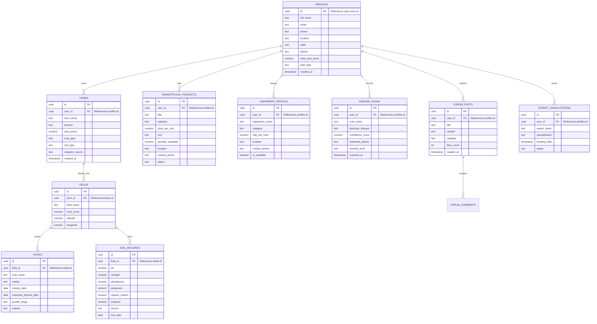
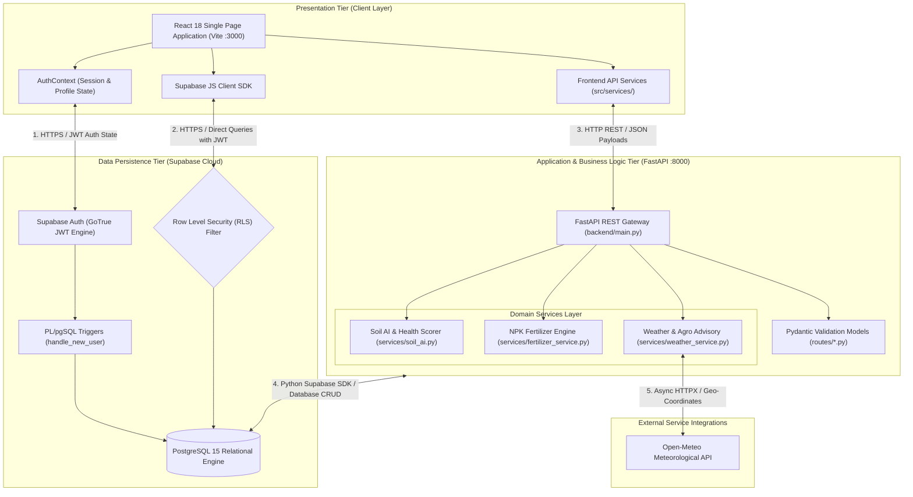
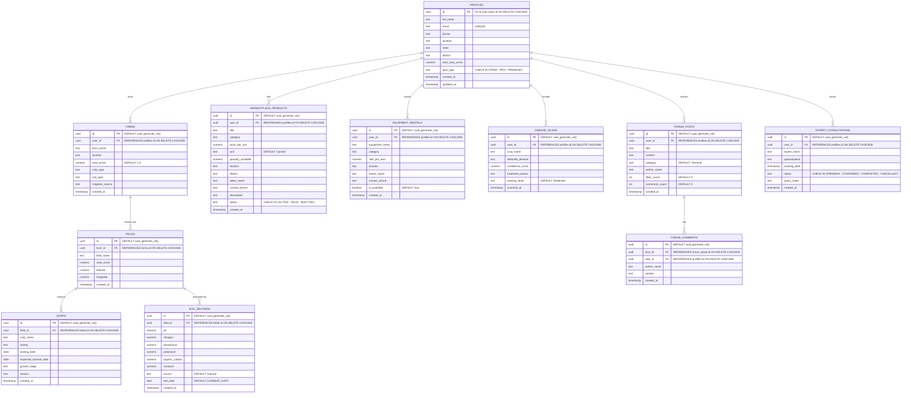

# 🌾 AgriAI 366: Intelligent Smart Agriculture Ecosystem

[](https://github.com/ashish-987/Agri-AI-366)
[](https://react.dev/)
[](https://vitejs.dev/)
[](https://fastapi.tiangolo.com/)
[](https://www.python.org/)
[](https://supabase.com/)
[](https://tailwindcss.com/)
[](LICENSE)

> **AgriAI 366** is a comprehensive, production-grade digital agriculture platform designed to empower Indian smallholder farmers, agronomists, and rural cooperatives. It bridges agronomic science and modern technology through real-time weather intelligence, soil health evaluation, targeted fertilizer advisory, disease diagnostics, digital farm records, and an agricultural marketplace.

---

## 📑 Table of Contents

- [Vision & Problem Statement](#-vision--problem-statement)
- [System Architecture](#-system-architecture)
- [Core Features & Verified Implementation Status](#-core-features--verified-implementation-status)
- [Technology Stack](#-technology-stack)
- [Database Schema & ER Architecture](#-database-schema--er-architecture)
- [Project Directory Structure](#-project-directory-structure)
- [Computer Science Concepts Applied](#-computer-science-concepts-applied)
  - [A. Cyber Security Implementation](#a-cyber-security-implementation)
  - [B. System Design and Architecture](#b-system-design-and-architecture)
  - [C. DBMS Concepts Applied](#c-dbms-concepts-applied)
  - [D. Software Engineering Principles](#d-software-engineering-principles)
  - [E. Computer Science Concepts Implementation Mapping](#e-computer-science-concepts-implementation-mapping)
  - [F. Real-World End-to-End Data Flow Tracing](#f-real-world-end-to-end-data-flow-tracing)
- [Step-by-Step Installation & Local Setup](#-step-by-step-installation--local-setup)
  - [Prerequisites](#prerequisites)
  - [Step 1: Clone Repository](#step-1-clone-repository)
  - [Step 2: Frontend Setup](#step-2-frontend-setup)
  - [Step 3: Supabase Setup & SQL Schema](#step-3-supabase-setup--sql-schema)
  - [Step 4: Backend Setup](#step-4-backend-setup)
  - [Step 5: Run Backend](#step-5-run-backend)
  - [Step 6: Run Frontend](#step-6-run-frontend)
  - [Step 7: Verify Installation](#step-7-verify-installation)
- [Environment Variables Reference](#-environment-variables-reference)
- [API Reference & Endpoint Documentation](#-api-reference--endpoint-documentation)
- [Production Deployment Guide](#-production-deployment-guide)
  - [Frontend Deployment (Netlify)](#frontend-deployment-netlify)
  - [Backend Deployment (Render)](#backend-deployment-render)
  - [Supabase Production Hardening](#supabase-production-hardening)
- [Security Auditing & Troubleshooting](#-security-auditing--troubleshooting)
- [Audit Findings: Discovered Issues & Technical Debt](#-audit-findings-discovered-issues--technical-debt)
- [Contributing Guidelines](#-contributing-guidelines)
- [License & Maintainer](#-license--maintainer)

---

## 💡 Vision & Problem Statement

### The Problem
Indian smallholder farmers face critical vulnerabilities that depress agricultural yield and farm profitability:
1. **Unpredictable Weather Risks:** Sudden localized rainfall, extreme heat, or frost damage crops when farmers lack timely hyper-local weather alerts.
2. **Imbalanced Soil Nutrition:** Blind fertilizer broadcasting without N-P-K nutrient testing causes soil acidification, chemical runoff, and high operational expenditure.
3. **Fragmented Plot Records:** Farmers lack systematic digital tracking for plot boundaries, sowing dates, variety history, and crop life-cycles.
4. **Delayed Pathogen Identification:** Pests and fungal blights destroy yields before agronomists can inspect fields in person.
5. **Middlemen Exploitation:** Farmers lack direct peer-to-peer marketplaces to discover mandi prices, rent heavy machinery (tractors, harvesters), or sell produce directly.

### The Solution: AgriAI 366
AgriAI 366 unifies critical farm operations into a streamlined web platform:
- **Hyper-Local Weather Intelligence:** Free, accurate meteorological forecasts and agricultural advisories via the Open-Meteo REST API.
- **Precision Soil & Fertilizer Advisory:** Mathematical soil health scoring (0–100) and crop-specific N-P-K nutrient dosage calculation.
- **Farm, Field & Crop Management:** Multi-tier farm hierarchy (`farms` ➔ `fields` ➔ `crops`) for detailed lifecycle and acreage tracking.
- **AI Diagnostics & Multimodal Assistant:** Instant leaf disease diagnosis and browser-native voice agronomist interaction.
- **Peer-to-Peer Rural Marketplace:** Buy and sell agricultural produce, list farm machinery for rent, and book verified agronomist consultations.

---

## 🏗 System Architecture

AgriAI 366 is built on a modern decoupled architecture:
- **Client Tier:** React 18 single-page application bundled with Vite, styled with Tailwind CSS, and rendered with custom WebGL/Three.js visual shaders.
- **Authentication & Identity:** Supabase GoTrue Auth issuing signed JSON Web Tokens (JWT) for secure session persistence.
- **Microservices Backend:** Python FastAPI application serving weather calculations, soil scoring, fertilizer recommendations, and administrative endpoints.
- **Persistence Tier:** Supabase PostgreSQL with Row Level Security (RLS) guaranteeing strict multi-tenant farmer data isolation.

```mermaid
flowchart TD
    Farmer([Farmer / User]) <-->|Browser UI| ReactApp["React 18 Frontend (Vite :3000)"]

    subgraph ClientLayer ["Client Presentation & State"]
        ReactApp <--> AuthContext["AuthContext (Supabase Session Listener)"]
        ReactApp <--> ApiClient["src/services/api.js (FastAPI Connector)"]
        ReactApp <--> SupabaseJS["src/lib/supabase.js (Supabase Client SDK)"]
    end

    subgraph AuthGateway ["Authentication & Security Gateway"]
        SupabaseAuth["Supabase Auth (JWT / GoTrue)"]
        RLS["PostgreSQL Row-Level Security (RLS)"]
    end

    subgraph BackendGateway ["Compute & Advisory Engine (FastAPI :8000)"]
        FastAPI["FastAPI Gateway (backend/main.py)"]
        WeatherService["Weather & Forecast Service (Open-Meteo API)"]
        SoilService["Soil AI & Scoring Engine (0-100 Score)"]
        FertilizerService["Fertilizer Optimization Service (NPK Balancer)"]
        FarmRouter["Farms, Fields & Crops CRUD Controller"]

        FastAPI --> WeatherService
        FastAPI --> SoilService
        FastAPI --> FertilizerService
        FastAPI --> FarmRouter
    end

    subgraph DataPersistence ["Cloud Data Tier (Supabase PostgreSQL)"]
        DBProfiles[("profiles")]
        DBFarms[("farms")]
        DBFields[("fields")]
        DBCrops[("crops")]
        DBSoil[("soil_records")]
        DBMarket[("marketplace_products")]
        DBRentals[("equipment_rentals")]
        DBScans[("disease_scans")]
        DBForum[("forum_posts & comments")]
        DBConsult[("expert_consultations")]
    end

    AuthContext <-->|Sign Up / Login / OAuth| SupabaseAuth
    SupabaseJS <-->|Direct RLS Data Queries| DataPersistence
    ApiClient <-->|Advisory & Weather Calls| FastAPI
    FarmRouter <-->|Server-side CRUD via Service Role| DataPersistence
    SupabaseAuth -->|Validates auth.uid()| RLS
    RLS --> DataPersistence
```

### Complete End-to-End Data Flow

```text
1. Authentication: Farmer signs in via AuthModal -> Supabase Auth sets JWT in localStorage -> Profiles table trigger auto-provisions farmer record.
2. Farm Creation: Farmer registers "Punjab Agro Farm" (5 Acres) -> POST /farms -> Row inserted into Supabase 'farms' table with user_id = auth.uid().
3. Field & Crop Setup: Farmer adds "North Field" (2 Acres) planted with "Sharbati Wheat" -> Rows written to 'fields' and 'crops' tables.
4. Weather Advisory: Frontend requests GET /weather/advisory?latitude=30.9&longitude=75.85 -> FastAPI calls Open-Meteo -> Returns temperature, humidity, and actionable irrigation advice.
5. Soil Testing: Farmer submits N: 180, P: 14, K: 190, pH: 6.8 -> FastAPI evaluates soil health score -> Returns specific Urea, DAP, and MOP dosage schedule.
6. Marketplace & Equipment: Farmer lists tractor for rent -> Record saved to 'equipment_rentals' -> Visible immediately to all regional farmers.
```

---

## 🌟 Core Features & Verified Implementation Status

| Feature Module | Verification Status | Implementation Architecture | Notes |
|---|---|---|---|
| **1. Smart Farming Dashboard** | ✅ **Fully Implemented** | React (`src/pages/Home.jsx`), Chart.js | Visualizes quick stats, weather summaries, active crops, and quick action cards. |
| **2. Farmer Registration & Login** | ✅ **Fully Implemented** | `src/components/AuthModal.jsx`, `src/lib/supabaseAuth.js` | Supports Email/Password authentication, session restoration, and Google OAuth hooks. |
| **3. AI Crop Disease Detection** | 🟨 **Partially Implemented** | `src/pages/DiseaseScan.jsx`, `backend/ml_training/` | UI supports leaf photo upload, pathology encyclopedia, and sample diagnostics; CNN weights require deployment in backend. |
| **4. Soil Health Analysis** | ✅ **Fully Implemented** | `backend/routes/soil.py`, `backend/services/soil_ai.py` | Calculates aggregate soil score (0–100) across pH, N, P, K, organic carbon, and moisture. |
| **5. Fertilizer Recommendation** | ✅ **Fully Implemented** | `backend/routes/fertilizer.py`, `backend/services/fertilizer_service.py` | Recommends commercial fertilizers (Urea, DAP, MOP) based on target crop nutrient thresholds. |
| **6. Weather Intelligence** | ✅ **Fully Implemented** | `backend/routes/weather.py`, `backend/services/weather_service.py` | Integrated with Open-Meteo API (no external API key required); provides 7-day agricultural forecasts. |
| **7. Crop Management** | ✅ **Fully Implemented** | `src/pages/CropManagement.jsx`, `backend/routes/crops.py` | Full CRUD for crops, sowing dates, variety tracking, and harvest timeline management. |
| **8. Farm & Field Management** | ✅ **Fully Implemented** | `src/pages/FarmManagement.jsx`, `src/pages/FieldManagement.jsx` | Multi-tier farm hierarchy mapping plots to acreage, soil types, and irrigation sources. |
| **9. Farmer Market Linkage** | ✅ **Fully Implemented** | `src/pages/Marketplace.jsx`, Supabase DB | Real-time produce listings with price per quintal, quantity, seller contact, and district mandis. |
| **10. Agri Equipment Rental** | ✅ **Fully Implemented** | `src/pages/EquipmentHub.jsx`, Supabase DB | Peer-to-peer machinery sharing (Tractors, Seeders, Drones) with hourly pricing and contact rails. |
| **11. Community Forum** | ✅ **Fully Implemented** | `src/pages/CommunityForum.jsx`, Supabase DB | Interactive farmer discussion forum with category tagging, likes, and comment threads. |
| **12. Expert Consultations** | ✅ **Fully Implemented** | `src/pages/ExpertConsultation.jsx`, Supabase DB | Booking pipeline for certified agronomists and crop specialists with schedule tracking. |
| **13. AI Voice Agronomist** | 🟨 **Partially Implemented** | `src/pages/AiAssistant.jsx` | Browser-native SpeechSynthesis and SpeechRecognition with agronomic advisory decision trees. |
| **14. Multilingual Agricultural Assistance** | 🟨 **Partially Implemented** | `src/i18n/` | Static dictionary architecture supporting English and Hindi UI labels. |
| **15. Digital Twin Farm View** | 🟨 **Partially Implemented** | `src/components/ThreeLeafCanvas.jsx`, Three.js | Interactive 3D WebGL leaf and plot shader canvases; full IoT sensor synchronization is planned. |

---

## 🛠 Technology Stack

### Frontend Ecosystem
- **Core Library:** React 18.2.0
- **Build Tool:** Vite 5.1.4 (configured to run on `http://localhost:3000`)
- **Styling & Design:** Tailwind CSS 3.4.1, PostCSS 8.4.35, Autoprefixer 10.4.18
- **Icons:** Lucide React 0.344.0
- **3D Graphics & Shaders:** Three.js 0.160.0
- **Data Visualization:** Chart.js 4.4.1, React-Chartjs-2 5.2.0
- **Client Data Layer:** `@supabase/supabase-js` 2.112.3, `@supabase/ssr` 0.12.4

### Backend Ecosystem
- **Framework:** FastAPI 0.100+
- **ASGI Server:** Uvicorn 0.16.0+ (with standard async workers)
- **Validation & Typing:** Pydantic v2
- **HTTP Client:** HTTPX 0.28.1 (asynchronous weather queries)
- **Database Connector:** `supabase-py` (Python Supabase client)
- **Environment Management:** Python-Dotenv 1.0+

### Database & Authentication
- **Provider:** Supabase
- **Database Engine:** PostgreSQL 15+
- **Security:** Row Level Security (RLS) policies, PL/pgSQL database triggers, UUID Primary Keys
- **Auth Engine:** Supabase GoTrue (Email, Password, OAuth)

### External APIs & Integrations
- **Weather Provider:** Open-Meteo REST API (`https://api.open-meteo.com/v1/forecast`) — zero API keys required, zero rate-limit friction for development.
- **Storage:** Supabase Storage (for disease scan uploads and produce photos).

---

## 🗄 Database Schema & ER Architecture

The database is built on a normalized PostgreSQL schema with Row Level Security (RLS) enabled on all public tables:



### Row Level Security (RLS) Policy Summary
- **Profiles:** Public profiles are viewable by all users; insert/update restricted to `auth.uid() = id`.
- **Farms & Fields:** Users can only view, insert, update, or delete records where `user_id = auth.uid()`.
- **Marketplace & Equipment:** Items are publicly readable by everyone; only the listing owner can update or delete.
- **Disease History:** Scans are private to the farmer (`auth.uid() = user_id`).

---

## 📁 Project Directory Structure

```text
Agri-AI-366/
├── backend/
│   ├── models/
│   │   ├── __init__.py
│   │   └── schemas.py              # Pydantic request/response validation models
│   ├── routes/
│   │   ├── __init__.py
│   │   ├── ai.py                   # AI intelligence placeholder router
│   │   ├── crops.py                # Crop lifecycle CRUD endpoints
│   │   ├── farms.py                # Farm management endpoints
│   │   ├── fertilizer.py           # Crop NPK recommendation endpoints
│   │   ├── fields.py               # Field partition management
│   │   ├── health.py               # Microservice health check (/health)
│   │   ├── soil.py                 # Soil analysis & health scoring routes
│   │   └── weather.py              # Open-Meteo weather and agricultural advisories
│   ├── services/
│   │   ├── __init__.py
│   │   ├── advisory_service.py     # Weather advisory rule engine
│   │   ├── ai_service.py           # Core agronomic AI helpers
│   │   ├── fertilizer_service.py   # Crop nutrient deficit calculation
│   │   ├── forecast_service.py     # 7-day agricultural forecast metrics
│   │   ├── soil_ai.py              # Soil health scoring algorithm (0-100)
│   │   ├── soil_service.py         # Soil record data access layer
│   │   └── weather_service.py      # Async Open-Meteo HTTP client
│   ├── database.py                 # Supabase client export
│   ├── main.py                     # FastAPI ASGI application entrypoint
│   ├── requirements.txt            # Python backend dependencies
│   ├── supabase_client.py          # Supabase client initialization
│   └── .env                        # Backend environment configuration
├── public/
│   ├── assets/                     # Static media, crop images, portraits
│   └── _redirects                  # Netlify SPA routing rules
├── src/
│   ├── components/
│   │   ├── AuthModal.jsx           # Farmer authentication modal (Supabase)
│   │   ├── BackendTest.jsx         # Live FastAPI connectivity widget
│   │   ├── Footer.jsx              # Application footer
│   │   ├── Navbar.jsx              # Navigation header with auth controls
│   │   ├── Sidebar.jsx             # Collapsible navigation drawer
│   │   ├── ThreeLeafCanvas.jsx     # Interactive Three.js 3D leaf model
│   │   ├── WeatherTest.jsx         # Diagnostic weather widget
│   │   └── WebGLShaderCanvas.jsx   # Ambient WebGL background shader
│   ├── context/
│   │   └── AuthContext.jsx         # Global Supabase authentication provider
│   ├── i18n/                       # Multilingual dictionary tables
│   ├── lib/
│   │   ├── supabase.js             # Supabase JS client instance
│   │   └── supabaseAuth.js         # Authentication helpers (Sign Up, Login, OAuth)
│   ├── pages/
│   │   ├── AiAssistant.jsx         # AI Voice Agronomist interface
│   │   ├── CommunityForum.jsx      # Farmer peer discussion boards
│   │   ├── CropManagement.jsx      # Crop varieties & lifecycle tracking
│   │   ├── DiseaseScan.jsx         # Leaf disease image diagnosis scanner
│   │   ├── EquipmentHub.jsx        # Heavy farm machinery rental hub
│   │   ├── ExpertConsultation.jsx  # Agronomist appointment booking
│   │   ├── FarmManagement.jsx      # Farm overview & plot registration
│   │   ├── FieldManagement.jsx     # Field partition & acreage manager
│   │   ├── Home.jsx                # Main landing & farmer overview
│   │   ├── Marketplace.jsx         # Agricultural produce digital mandi
│   │   ├── Settings.jsx            # User profile and notification preferences
│   │   ├── SoilHealth.jsx          # Soil nutrient testing & advisory
│   │   └── WeatherIntel.jsx        # Detailed 7-day meteorological forecast
│   ├── services/
│   │   ├── api.js                  # Primary FastAPI REST connector
│   │   ├── cropService.js          # Crop management API client
│   │   ├── farmService.js          # Farm management API client
│   │   ├── fieldService.js         # Field management API client
│   │   └── soilService.js          # Soil health API client
│   ├── App.jsx                     # Root application component with tab routing
│   ├── index.css                   # Tailwind CSS root stylesheet
│   └── main.jsx                    # React entrypoint
├── index.html                      # HTML5 template
├── netlify.toml                    # Netlify deployment configuration
├── package.json                    # Node.js dependencies and run scripts
├── postcss.config.js               # PostCSS plugin configuration
├── supabase_schema.sql             # Complete PostgreSQL database schema
├── SUPABASE_SETUP.md               # Supabase configuration instructions
├── DATABASE_STATUS.md              # Live connection test report
├── tailwind.config.js              # Tailwind design tokens
└── vite.config.js                  # Vite bundler configuration
```

---

## 🧠 Computer Science Concepts Applied

This section details how core theoretical Computer Science disciplines—**Cybersecurity**, **System Design & Distributed Systems**, **Database Management Systems (DBMS)**, and **Software Engineering**—are practically implemented across the AgriAI 366 codebase.

---

### A. Cyber Security Implementation

The platform employs defense-in-depth principles across the presentation, logic, and persistence tiers.

```
+-------------------------------------------------------------------------------------------------------+
|                                    CYBERSECURITY ARCHITECTURE                                         |
+------------------------------------+----------------------------------+-------------------------------+
|       CLIENT BROWSER LAYER         |       API GATEWAY / LOGIC        |     DATABASE PERSISTENCE      |
|  • JWT Bearer Token in Storage     |  • FastAPI CORS Whitelisting     |  • Row-Level Security (RLS)   |
|  • Public Anon Key (Bounded Scope) |  • Pydantic Strict Type Checking |  • DB Triggers (Auth -> User) |
|  • Client-Side Validation Guard    |  • Isolated Service Role Secret  |  • Foreign Key Cascade Bounds |
+------------------------------------+----------------------------------+-------------------------------+
```

#### 1. Authentication and Authorization
- **Conceptual Definition:** *Authentication* verifies identity claims (determining "who the user is"), while *Authorization* establishes resource access entitlements (determining "what the authenticated identity is permitted to perform").
- **Where Used in Project:** User authentication entrypoints in [`src/lib/supabaseAuth.js`](src/lib/supabaseAuth.js), global state synchronization in [`src/context/AuthContext.jsx`](src/context/AuthContext.jsx), and database-level enforcement in [`supabase_schema.sql`](supabase_schema.sql).
- **Implementation Mechanics:** Farmers authenticate via email/password credentials or third-party OAuth through Supabase GoTrue Auth (`supabase.auth.signInWithPassword` or `signUpWithEmail`). Upon verification, the identity provider returns a cryptographically signed JSON Web Token (JWT) encapsulating standard user claims (including `sub`, representing the farmer's unique UUID). The client session is preserved and rehydrated via `supabase.auth.getSession()` and `supabase.auth.onAuthStateChange()`.
- **Vulnerability Prevented:** Prevents Broken Authentication (OWASP A07), credential sniffing, unauthorized impersonation, and identity spoofing across application sessions.

#### 2. JSON Web Token (JWT) Stateless Session Management
- **Conceptual Definition:** JWT (RFC 7519) is an open industry standard that defines a compact, self-contained mechanism for securely transmitting information between parties as a verifiable JSON object.
- **Where Used in Project:** [`src/context/AuthContext.jsx`](src/context/AuthContext.jsx), [`src/lib/supabase.js`](src/lib/supabase.js), and database query authorization.
- **Implementation Mechanics:** Rather than storing stateful session IDs in server memory tables or cache clusters, authentication state is represented as a signed JWT bearer token. On every direct database request executed via `@supabase/supabase-js`, the client injects the token in the HTTP `Authorization: Bearer <TOKEN>` header. PostgreSQL decodes the token payload to extract `auth.uid()`, binding query evaluation to the caller's identity without persistent server-side session overhead.
- **Vulnerability Prevented:** Eliminates session hijacking via session prediction, memory exhaustion attacks on session state caches, and session fixation vulnerabilities.

#### 3. Row Level Security (RLS) and Tenant Data Isolation
- **Conceptual Definition:** Row Level Security is an access control mechanism implemented directly within the database engine where individual row access is determined by evaluating boolean predicate security policies during SQL query execution.
- **Where Used in Project:** Enforced across all relational tables in [`supabase_schema.sql`](supabase_schema.sql), specifically `profiles`, `farms`, `fields`, `crops`, `soil_records`, `disease_scans`, `marketplace_products`, and `equipment_rentals`.
- **Implementation Mechanics:** RLS is explicitly activated on tables via `ALTER TABLE <table_name> ENABLE ROW LEVEL SECURITY;`. Policies bind data mutations and reads to the token identity:
  ```sql
  -- Example from supabase_schema.sql
  CREATE POLICY "Users can view their own farms"
      ON public.farms FOR SELECT USING (auth.uid() = user_id);

  CREATE POLICY "Users can insert their own farms"
      ON public.farms FOR INSERT WITH CHECK (auth.uid() = user_id);

  CREATE POLICY "Users can update their own farms"
      ON public.farms FOR UPDATE USING (auth.uid() = user_id);

  CREATE POLICY "Users can delete their own farms"
      ON public.farms FOR DELETE USING (auth.uid() = user_id);
  ```
  Even if a malicious user alters client parameters to request `SELECT * FROM farms WHERE id = 'target-id'`, PostgreSQL executes the query through the filter `AND user_id = auth.uid()`. Unowned rows are completely invisible.
- **Vulnerability Prevented:** Mitigates Broken Object Level Authorization (BOLA / IDOR - Insecure Direct Object References) and cross-tenant data leakage in multi-user deployments.

#### 4. Role and Ownership-Based Access Control (OBAC)
- **Conceptual Definition:** Ownership-Based Access Control restricts mutation (update, delete) and sensitive viewing permissions strictly to the authenticated entity that created the asset, while allowing broader public read visibility for shared resources.
- **Where Used in Project:** Public marketplace and community forum tables in [`supabase_schema.sql`](supabase_schema.sql).
- **Implementation Mechanics:** The schema implements differentiated access policies on `marketplace_products`, `equipment_rentals`, and `forum_posts`:
  - **Public Read (Catalog Access):** `FOR SELECT USING (true)` enables all users (including unauthenticated visitors) to browse mandi grain prices and available tractor rentals.
  - **Owner-Exclusive Mutation:** `FOR UPDATE USING (auth.uid() = user_id)` and `FOR DELETE USING (auth.uid() = user_id)` ensure that only the selling farmer who originally listed the item can edit its price, update stock quantity, or delete the listing.
- **Vulnerability Prevented:** Prevents unauthorized tampering, price manipulation, and malicious deletion of marketplace listings by competitor users (Privilege Escalation - OWASP A01).

#### 5. Credential Segregation and Environment Variable Security
- **Conceptual Definition:** Principle of least privilege applied to secret management, ensuring sensitive administrative credentials are never distributed to client runtimes or committed into version control systems.
- **Where Used in Project:** Root [`.env`](.env), frontend environment [`.env.local`](.env.local), [`.gitignore`](.gitignore), [`backend/.env`](backend/.env), [`src/lib/supabase.js`](src/lib/supabase.js), and [`backend/supabase_client.py`](backend/supabase_client.py).
- **Implementation Mechanics:**
  - **Client Runtime:** Exposed frontend variables are constrained to public variables (`VITE_SUPABASE_URL`, `VITE_SUPABASE_PUBLISHABLE_KEY`). The public publishable key possesses strictly bounded permissions governed by RLS.
  - **Server Runtime:** The high-privilege `SUPABASE_SECRET_KEY` (service role) is isolated inside `backend/.env`. It is loaded only on the server through `python-dotenv` and is explicitly listed in `backend/.gitignore` to prevent leakage into Git repositories.
- **Vulnerability Prevented:** Prevents credential exposure, source code secret leakage, and administrative database compromise.

#### 6. Backend Input Validation and Schema Enforcement via Pydantic
- **Conceptual Definition:** Strict server-side data boundary validation ensuring all inbound data conforms to declared data types, structural constraints, and ranges prior to execution within application business logic.
- **Where Used in Project:** REST endpoints in [`backend/routes/farms.py`](backend/routes/farms.py), [`backend/routes/fields.py`](backend/routes/fields.py), [`backend/routes/crops.py`](backend/routes/crops.py), [`backend/routes/soil.py`](backend/routes/soil.py), and [`backend/models/schemas.py`](backend/models/schemas.py).
- **Implementation Mechanics:** FastAPI integrates Pydantic v2 schemas (`FarmCreate`, `FieldCreate`, `CropCreate`, `SoilAnalyzeRequest`). Every incoming JSON payload is validated at the ASGI boundary:
  ```python
  class SoilAnalyzeRequest(BaseModel):
      field_id: str
      ph: float
      nitrogen: float
      phosphorus: float
      potassium: float
      organic_carbon: float
      moisture: float
      source: Optional[str] = "manual"
      test_date: Optional[str] = None
  ```
  If an invalid data type (such as passing a string into `ph` or missing required coordinate fields) is submitted, FastAPI rejects the request with an immediate HTTP 422 Unprocessable Entity, short-circuiting execution before database interaction.
- **Vulnerability Prevented:** Protects against type confusion, format string bugs, malformed JSON injection, and unexpected runtime server crashes.

#### 7. Cross-Origin Resource Sharing (CORS) Policy
- **Conceptual Definition:** A security standard implemented by web browsers that restricts cross-origin HTTP requests originating from client scripts to origins explicitly permitted by the receiving server.
- **Where Used in Project:** Server configuration in [`backend/main.py`](backend/main.py).
- **Implementation Mechanics:** FastAPI's `CORSMiddleware` explicitly defines allowed origins:
  ```python
  app.add_middleware(
      CORSMiddleware,
      allow_origins=[
          "http://localhost:3000",
          "http://127.0.0.1:3000",
          "https://agri-ai-366.netlify.app",
      ],
      allow_credentials=True,
      allow_methods=["*"],
      allow_headers=["*"],
  )
  ```
- **Vulnerability Prevented:** Mitigates Cross-Site Request Forgery (CSRF) vectors and blocks arbitrary third-party websites from executing unauthorized background requests against local or production backend APIs.

> [!NOTE]
> **Security Audit Scope & Boundary Verification:** The project uses managed HTTPS/TLS via Supabase and modern cloud hosting for transport security, along with parameterized database queries via Supabase client libraries (mitigating standard SQL injection). Production-grade features such as Web Application Firewalls (WAF), distributed rate limiting (e.g., Redis token bucket), and field-level encryption at rest are outside the current academic deployment scope.

---

### B. System Design and Architecture

AgriAI 366 adheres to a classic **Three-Tier Architecture** implemented across modern, decoupled components.



#### 1. Three-Tier Architectural Decomposition

1. **Presentation Tier (Client Layer):**
   - Implemented as a single-page application (SPA) using React 18, bundled with Vite, and rendered with Tailwind CSS.
   - Responsible strictly for user interaction, visual rendering, charting (Chart.js), client-side state caching, and responsive design.
   - Completely decoupled from database drivers and operating system primitives; communicates exclusively over HTTPS/REST.

2. **Application & Business Logic Tier (FastAPI Layer):**
   - Implemented using Python 3.11 and FastAPI over an asynchronous Uvicorn ASGI server.
   - Encapsulates pure domain logic and scientific calculations:
     - Soil health evaluation algorithm (0–100 scoring based on non-linear agronomic thresholds in [`backend/services/soil_ai.py`](backend/services/soil_ai.py)).
     - Fertilizer deficit balancing formulas (Urea, DAP, and MOP dosage calculators in [`backend/services/fertilizer_service.py`](backend/services/fertilizer_service.py)).
     - Agro-meteorological advisory rules derived from weather parameters ([`backend/services/advisory_service.py`](backend/services/advisory_service.py)).
   - Exposes RESTful endpoints conforming to the OpenAPI / Swagger specification.

3. **Data Persistence Tier (Supabase / PostgreSQL Layer):**
   - Managed PostgreSQL 15 database handling relational tables, foreign key constraints, and multi-tenant isolation.
   - Houses procedural database triggers (`handle_new_user()`) written in PL/pgSQL for automatic profile provisioning.

#### 2. Architectural Design Patterns & Principles

- **Client-Server Separation:** The client and server run on distinct ports (`3000` and `8000`) and can be hosted across completely separate infrastructure providers (e.g., Netlify for static frontend assets and Render for the Python API server).
- **Separation of Concerns (SoC):**
  - UI components in `src/pages/` do not perform raw HTTP fetching or SQL queries directly; they delegate to centralized services in `src/services/`.
  - Backend routing controllers in `backend/routes/` do not execute mathematical formulas directly; they delegate to dedicated domain services in `backend/services/`.
- **Stateless Backend Design:** The FastAPI server maintains zero in-memory session state between incoming requests. Each request carries its full context or delegates identity resolution to the database, enabling seamless horizontal scalability behind a load balancer.
- **External Integration Pattern:** The weather subsystem decouples external dependencies via an asynchronous HTTP client (`httpx.AsyncClient` in [`backend/services/weather_service.py`](backend/services/weather_service.py)) targeting the Open-Meteo REST API. This shields core application logic from external API latency and contract changes.

---

### C. DBMS Concepts Applied

The database tier is designed using relational principles implemented in PostgreSQL.



#### 1. Entity-Relationship Modeling & Cardinality
The database schema models physical agricultural structures into structured relational entities:
- **One-to-Many ($1:N$) Hierarchical Agronomic Structure:**
  - `profiles` $\rightarrow$ `farms`: A single farmer owns multiple distinct farms ($1:N$).
  - `farms` $\rightarrow$ `fields`: A farm is partitioned into multiple physical plots or fields ($1:N$).
  - `fields` $\rightarrow$ `crops`: A field can support multiple crop rotations or seasonal plantings ($1:N$).
  - `fields` $\rightarrow$ `soil_records`: A field undergoes periodic soil testing over time ($1:N$).
- **One-to-Many ($1:N$) Marketplace & Social Relations:**
  - `profiles` $\rightarrow$ `marketplace_products`: A farmer lists multiple produce commodities for sale ($1:N$).
  - `profiles` $\rightarrow$ `equipment_rentals`: A farmer leases multiple agricultural machinery assets ($1:N$).
  - `forum_posts` $\rightarrow$ `forum_comments`: A community thread receives multiple farmer responses ($1:N$).

#### 2. Primary Keys, Foreign Keys, and Referential Integrity
- **Surrogate Keys using UUIDs:** All tables use universally unique identifiers (`UUID PRIMARY KEY DEFAULT uuid_generate_v4()`). This prevents key enumeration attacks and ensures collision-free distributed ID generation.
- **Referential Integrity Constraints:** Foreign key references (`REFERENCES public.profiles(id)`) strictly enforce valid relational links between child and parent tables.
- **Cascading Deletions:** All foreign key definitions specify `ON DELETE CASCADE`. If a user deletes their profile, PostgreSQL automatically deletes all linked farms, fields, crops, and listings in a single atomic database operation, preventing orphan records and dangling references.

#### 3. Database Normalization Analysis
The agricultural management subsystem is normalized up to **Third Normal Form (3NF)**:
- **First Normal Form (1NF):**
  - All attributes contain atomic, indivisible values (e.g., `ph`, `nitrogen`, `latitude`, `longitude` are distinct scalar values).
  - No repeating groups or arrays are stored in multi-value table columns.
  - Every table possesses an unambiguous primary key (`id`).
- **Second Normal Form (2NF):**
  - The schema satisfies 1NF.
  - All tables use single-column primary keys (`UUID id`). Therefore, partial functional dependencies on composite candidate keys are mathematically impossible; all non-key attributes are fully functionally dependent on the primary key.
- **Third Normal Form (3NF):**
  - The schema satisfies 2NF.
  - There are no transitive functional dependencies ($X \rightarrow Y$ and $Y \rightarrow Z$). For example, field acreage and GPS coordinates are stored in `fields`, while crop variety and sowing dates are stored in `crops`. Farmer metadata (phone, state, district) is stored solely in `profiles`, rather than duplicated across every farm, field, or crop row. This eliminates update anomalies and redundant data storage.

#### 4. Domain Integrity Constraints & Data Validation
PostgreSQL engine-level constraints guarantee that invalid data cannot be committed to disk:
- **Domain Check Constraints:**
  - `plan_type TEXT DEFAULT 'FREE' CHECK (plan_type IN ('FREE', 'PRO', 'PREMIUM'))`
  - `status TEXT DEFAULT 'ACTIVE' CHECK (status IN ('ACTIVE', 'SOLD', 'INACTIVE'))`
  - `status TEXT DEFAULT 'PENDING' CHECK (status IN ('PENDING', 'CONFIRMED', 'COMPLETED', 'CANCELLED'))`
- **Mandatory Field Constraints:** `NOT NULL` constraints on crucial business fields (`full_name`, `email`, `farm_name`, `price_per_unit`).
- **Uniqueness Constraints:** `email TEXT UNIQUE NOT NULL` on `profiles` preventing duplicate registrations.
- **Precision Numeric Types:** Agricultural data utilizes exact fixed-point representation (`NUMERIC(8,2)` for acreage and `NUMERIC(10,2)` for financial prices) rather than imprecise IEEE floating-point types (`FLOAT`/`REAL`), preventing financial and volumetric rounding errors.

#### 5. Event-Driven Database Triggers (PL/pgSQL)
The database utilizes active database triggers to guarantee transaction atomicity between identity creation and relational profile provisioning:
```sql
CREATE OR REPLACE FUNCTION public.handle_new_user()
RETURNS TRIGGER AS $$
BEGIN
    INSERT INTO public.profiles (id, full_name, email, phone, avatar_url, plan_type)
    VALUES (
        NEW.id,
        COALESCE(NEW.raw_user_meta_data->>'full_name', NEW.raw_user_meta_data->>'name', 'Kisan Farmer'),
        NEW.email,
        COALESCE(NEW.raw_user_meta_data->>'phone', ''),
        COALESCE(NEW.raw_user_meta_data->>'avatar_url', 'https://images.unsplash.com/photo-1535713875002-d1d0cf377fde?auto=format&fit=crop&q=80&w=200'),
        'FREE'
    )
    ON CONFLICT (id) DO NOTHING;
    RETURN NEW;
END;
$$ LANGUAGE plpgsql SECURITY DEFINER;

CREATE TRIGGER on_auth_user_created
    AFTER INSERT ON auth.users
    FOR EACH ROW EXECUTE FUNCTION public.handle_new_user();
```
- **How It Works:** Whenever a new user signs up in the `auth.users` authentication table, PostgreSQL fires `on_auth_user_created`, which invokes `handle_new_user()`.
- **Why It Matters:** The trigger runs with `SECURITY DEFINER` privileges, automatically inserting the corresponding profile record into `public.profiles` with matching UUID. This guarantees that user profile creation is atomic, event-driven, and immune to client-side network interruptions during onboarding.

---

### D. Software Engineering Principles

The codebase exhibits core software engineering best practices that ensure maintainability, testability, and clean code hygiene.

```
AgriAI-366/
├── backend/                       # Logic & Application Tier
│   ├── models/schemas.py          # Data contract models (Pydantic)
│   ├── routes/                    # REST API route controllers
│   ├── services/                  # Pure agronomic domain business logic
│   └── database.py                # Database connection encapsulation
└── src/                           # Presentation Tier
    ├── components/                # Reusable UI component building blocks
    ├── context/AuthContext.jsx    # Global state management via React Context API
    ├── pages/                     # Routed page-level view components
    ├── services/                  # Transport abstraction for backend communication
    └── lib/                       # External SDK singleton initializations
```

#### 1. Modular Programming & High Cohesion / Low Coupling
- **High Cohesion:** Each module has a focused, single responsibility. For instance, [`backend/services/soil_ai.py`](backend/services/soil_ai.py) only evaluates soil nutrient metrics; [`backend/services/weather_service.py`](backend/services/weather_service.py) handles weather data retrieval.
- **Low Coupling:** Backend routing controllers (`backend/routes/farms.py`) do not contain raw SQL strings or tight algorithmic dependencies. They communicate through standard Python function interfaces and validated data models.

#### 2. Separation of Concerns (SoC)
The project strictly separates presentation, communication, business logic, and persistence:
- **Presentation Layer:** React components in `src/pages/` (e.g., `SoilHealth.jsx`) only handle user input and DOM updates.
- **Data Transport Layer:** Services in `src/services/` (e.g., `soilService.js`, `api.js`) isolate network calls, headers, and HTTP status handling from view code.
- **Business Logic Layer:** Python services in `backend/services/` execute computational rules without depending on the web framework.
- **Persistence Layer:** Database tables and RLS policies in `supabase_schema.sql` handle relational consistency and access rules independently of application code.

#### 3. Component Reusability & DRY (Don't Repeat Yourself)
- **UI Componentization:** Common interface elements are extracted into standalone, reusable components ([`src/components/Navbar.jsx`](src/components/Navbar.jsx), [`src/components/Sidebar.jsx`](src/components/Sidebar.jsx), [`src/components/Footer.jsx`](src/components/Footer.jsx), [`src/components/AuthModal.jsx`](src/components/AuthModal.jsx)).
- **Centralized API Wrapper:** [`src/services/api.js`](src/services/api.js) encapsulates the generic `apiRequest()` helper, standardizing JSON header injection, URL concatenation, and HTTP error unwrapping across all frontend calls.

#### 4. Defensive Programming & Graceful Error Handling
- **Server Boundary Protection:** Backend endpoints wrap database operations in `try-except` blocks, catching unexpected exceptions and returning structured HTTP status codes (`HTTPException(status_code=500, detail=...)`) to prevent server process crashes.
- **Client Offline Fallbacks:** [`src/lib/supabaseAuth.js`](src/lib/supabaseAuth.js) implements fallback mock profiles when running in test or demo environments where cloud credentials are intentionally unconfigured, allowing the frontend UI to remain functional for evaluation.

#### 5. Configuration Management & Environment Segregation
- System variables are decoupled from source code using `.env` files ([`.env.example`](.env.example), [`backend/.env`](backend/.env)).
- Variables are read dynamically via standard interfaces (`os.getenv()` in Python, `import.meta.env` in Vite), ensuring identical codebase operation across local development, staging, and production environments without code modification.

#### 6. API-First Contract Design
- Request and response formats are formally specified via Pydantic models. This establishes an explicit contract between client and server, automatically powers FastAPI's interactive OpenAPI documentation (`/docs`), and eliminates data shape ambiguities during team collaboration.

---

### E. Computer Science Concepts Implementation Mapping

The following mapping connects theoretical Computer Science concepts directly to verified source code implementations within this repository:

| Computer Science Concept | Actual Implementation in Project | Relevant File or Component | Practical Benefit |
|---|---|---|---|
| **Identity Authentication** | Supabase GoTrue Auth issuing signed cryptographic JWT tokens on email/password login | [`src/lib/supabaseAuth.js`](src/lib/supabaseAuth.js), [`src/context/AuthContext.jsx`](src/context/AuthContext.jsx) | Prevents credential theft; provides stateless identity verification across web sessions. |
| **Row Level Security (RLS)** | PostgreSQL engine-level row filtering using `auth.uid() = user_id` policies | [`supabase_schema.sql`](supabase_schema.sql) (Lines 28–188) | Prevents Broken Object Level Authorization (BOLA / IDOR) and cross-tenant farmer data leakage. |
| **Ownership-Based Access Control** | Public SELECT policy paired with owner-only UPDATE/DELETE policies | [`supabase_schema.sql`](supabase_schema.sql) (`marketplace_products`) | Allows buyers to view produce while restricting edits and deletions strictly to the listing owner. |
| **Data Boundary Validation** | Strict type and schema validation on incoming JSON payloads using Pydantic models | [`backend/routes/farms.py`](backend/routes/farms.py), [`backend/routes/soil.py`](backend/routes/soil.py) | Rejects malformed requests with HTTP 422 before logic executes; prevents type confusion bugs. |
| **Cross-Origin Security (CORS)** | Whitelist-based origin filtering via FastAPI `CORSMiddleware` | [`backend/main.py`](backend/main.py) (Lines 25–35) | Blocks unauthorized cross-origin API calls and mitigates CSRF vectors from third-party sites. |
| **Three-Tier Architecture** | Decoupled client (React :3000), logic (FastAPI :8000), and database (Supabase) | Project root, `backend/`, and Supabase Cloud | Enables independent scaling, clean maintenance, and isolated service deployments. |
| **Separation of Concerns (SoC)** | Separation of UI views, network transport helpers, route controllers, and calculation services | [`src/services/`](src/services/), [`backend/routes/`](backend/routes/), [`backend/services/`](backend/services/) | Improves modularity and codebase testability; logic changes do not break presentation components. |
| **External API Integration** | Asynchronous HTTP queries to the Open-Meteo REST API via `httpx.AsyncClient` | [`backend/services/weather_service.py`](backend/services/weather_service.py) | Provides real-time meteorological forecasts without blocking FastAPI worker threads. |
| **Relational Database Design** | Relational schema modeling $1:N$ hierarchy from farmers to farms, fields, and crops | [`supabase_schema.sql`](supabase_schema.sql), `README.md` (Step 3) | Eliminates data anomalies; models real-world agricultural hierarchies accurately. |
| **Referential Integrity** | Foreign key constraints with `ON DELETE CASCADE` across all child tables | [`supabase_schema.sql`](supabase_schema.sql) | Automatically cleans up dependent fields and crop records upon farm deletion; prevents orphan rows. |
| **Schema Normalization (3NF)** | Non-redundant attribute assignment ensuring fields depend only on primary keys | [`supabase_schema.sql`](supabase_schema.sql) (`profiles`, `farms`, `fields`) | Minimizes storage duplication and prevents insertion, update, and deletion anomalies. |
| **Domain Integrity Constraints** | Engine-level `CHECK`, `UNIQUE`, `NOT NULL`, and `NUMERIC(8,2)` constraints | [`supabase_schema.sql`](supabase_schema.sql) | Ensures stored values conform to valid business states directly at the database engine level. |
| **Active Database Triggers** | `handle_new_user()` PL/pgSQL function triggered `AFTER INSERT ON auth.users` | [`supabase_schema.sql`](supabase_schema.sql) (Lines 43–71) | Guarantees atomic, event-driven profile generation during signup with zero client dependency. |
| **Centralized State Management** | React Context API distributing authentication, profile, and session state | [`src/context/AuthContext.jsx`](src/context/AuthContext.jsx) | Eliminates prop drilling across the component hierarchy; keeps UI in sync with auth changes. |

---

### F. Real-World End-to-End Data Flow Tracing

To understand how these concepts operate during an actual agricultural workflow, consider the following end-to-end data tracing of a farmer using the platform:

```
[Farmer in Browser]
       │
       ▼ (1) Enters Email & Password
[src/components/AuthModal.jsx] ───> [src/lib/supabaseAuth.js]
                                              │
                                              ▼ (2) HTTPS POST to Supabase Auth
                                     [Supabase GoTrue Engine]
                                              │
                                              ├─► Issues JWT (Contains auth.uid)
                                              └─► Fires PL/pgSQL Trigger: on_auth_user_created
                                                          │
                                                          ▼
                                                  [public.profiles] (Auto-creates farmer profile)
       │
       ▼ (3) Registers Farm: "Punjab Agro Farm" (5 Acres)
[src/pages/FarmManagement.jsx] ───> [src/services/farmService.js]
                                              │
                                              ▼ (4) POST /farms/ (JSON Payload with user_id)
                                     [backend/routes/farms.py]
                                              │
                                              ├─► Pydantic FarmCreate validates types
                                              └─► Inserts row into public.farms
       │
       ▼ (5) Creates Field: "North Field" (2 Acres)
[src/pages/FieldManagement.jsx] ───> [src/services/fieldService.js] ───> POST /fields/ ───> [public.fields]
       │
       ▼ (6) Records Crop: "Wheat" (Variety: Sharbati)
[src/pages/CropManagement.jsx] ───> [src/services/cropService.js] ───> POST /crops/ ───> [public.crops]
       │
       ▼ (7) Submits Soil Test (pH: 6.8, N: 190, P: 18, K: 190)
[src/pages/SoilHealth.jsx] ───> [src/services/soilService.js]
                                              │
                                              ▼ (8) POST /soil/analyze
                                     [backend/routes/soil.py]
                                              │
                                              ├─► Validates via SoilAnalyzeRequest
                                              ├─► Inserts record into public.soil_records
                                              ├─► Executes calculate_soil_health() in services/soil_ai.py
                                              │     (Evaluates 0-100 score + agronomic alerts)
                                              └─► Returns JSON: { score: 76, recommendations: [...] }
       │
       ▼ (9) Renders Visual Feedback
[React Frontend] (Chart.js radar/doughnut charts display health scores and fertilizer schedule to farmer)
```

1. **Step 1: Farmer Authentication & Token Issuance:**
   The farmer enters credentials in [`src/components/AuthModal.jsx`](src/components/AuthModal.jsx). The client calls `signInWithEmail()` in [`src/lib/supabaseAuth.js`](src/lib/supabaseAuth.js), which initiates a secure TLS exchange with Supabase Auth. Upon validation, a signed JWT containing the farmer's unique identifier (`auth.uid()`) is returned and saved in browser storage. Concurrently, the database trigger `on_auth_user_created` ensures a corresponding record exists in `public.profiles`.
2. **Step 2: Farm Registration & Authorization:**
   The farmer navigates to [`src/pages/FarmManagement.jsx`](src/pages/FarmManagement.jsx) and creates "Punjab Agro Farm". The client service [`src/services/farmService.js`](src/services/farmService.js) issues an HTTP `POST` to `/farms/` on the FastAPI backend. FastAPI passes the body through `FarmCreate` validation in [`backend/routes/farms.py`](backend/routes/farms.py) and executes an insert into `public.farms`. The database's RLS policy enforces that `user_id = auth.uid()`.
3. **Step 3: Field Partitioning & Crop Assignment:**
   The farmer creates a sub-plot ("North Field", 2.0 Acres) in [`src/pages/FieldManagement.jsx`](src/pages/FieldManagement.jsx). The call routes through [`src/services/fieldService.js`](src/services/fieldService.js) to `POST /fields/`, creating a record in `public.fields` with `farm_id` as foreign key. The farmer then associates a crop ("Sharbati Wheat") via [`src/services/cropService.js`](src/services/cropService.js) targeting `POST /crops/`. Referential integrity ensures this crop row is directly linked to the valid field UUID.
4. **Step 4: Soil Health Analysis & Advisory Execution:**
   The farmer inputs soil nutrient values (pH: 6.8, Nitrogen: 190 kg/ha, Phosphorus: 18 kg/ha, Potassium: 190 kg/ha) in [`src/pages/SoilHealth.jsx`](src/pages/SoilHealth.jsx). The client invokes `createSoilRecord()` in [`src/services/soilService.js`](src/services/soilService.js), issuing an HTTP `POST` to `/soil/analyze`.
5. **Step 5: Algorithmic Evaluation & Data Persistence:**
   In [`backend/routes/soil.py`](backend/routes/soil.py), the `SoilAnalyzeRequest` Pydantic model parses and validates the numeric inputs. The route inserts the raw test record into `public.soil_records` for long-term historical trend tracking. Simultaneously, it calls `calculate_soil_health()` in [`backend/services/soil_ai.py`](backend/services/soil_ai.py), which evaluates non-linear agronomic scoring rules and returns an aggregate health score (e.g., 76/100) along with specific corrective recommendations.
6. **Step 6: Visual Presentation & Decision Support:**
   The backend returns the JSON response to the frontend. The React UI updates reactive state, rendering Chart.js visualizations that show the nutrient balance alongside specific fertilizer dosage recommendations (Urea, DAP, MOP) calculated by the backend service.

---

## 💻 Step-by-Step Installation & Local Setup

### Prerequisites
Ensure your workstation meets the following requirements before proceeding:
- **Operating System:** Windows 10/11, macOS (Intel or Apple Silicon), or Linux (Ubuntu 20.04+).
- **Node.js:** `v18.x` or `v20.x LTS` ([Download Node.js](https://nodejs.org/)).
- **Python:** `3.10` or `3.11` ([Download Python](https://www.python.org/downloads/)).
- **Git:** Version `2.30+` ([Download Git](https://git-scm.com/)).
- **Supabase Account:** Free cloud tier ([supabase.com](https://supabase.com/)).

---

### Step 1: Clone Repository

```bash
git clone https://github.com/ashish-987/Agri-AI-366.git
cd Agri-AI-366
```

---

### Step 2: Frontend Setup

1. In the project root, create your local environment file:
   ```bash
   cp .env.example .env
   ```
2. Open `.env` and configure your Supabase project parameters:
   ```ini
   VITE_SUPABASE_URL=https://your-project-id.supabase.co
   VITE_SUPABASE_ANON_KEY=your-supabase-anon-key
   VITE_API_BASE_URL=http://127.0.0.1:8000
   ```
3. Install frontend dependencies:
   ```bash
   npm install
   ```

---

### Step 3: Supabase Setup & SQL Schema

1. Log into your [Supabase Dashboard](https://supabase.com/dashboard) and create a **New Project**.
2. Select your nearest AWS Region (e.g., `ap-south-1 Mumbai`) and set a strong database password.
3. Once the database is ready, navigate to the **SQL Editor** in the left sidebar.
4. Copy the entire contents of [`supabase_schema.sql`](supabase_schema.sql) from the project root.
5. Paste it into the Supabase SQL Editor and click **Run**.
6. *(Important)* To ensure full backend compatibility with `fields`, `crops`, and `soil_records`, execute this additional migration block in the SQL Editor:
   ```sql
   -- Supplementary tables for field, crop, and soil records
   CREATE TABLE IF NOT EXISTS public.fields (
       id UUID PRIMARY KEY DEFAULT uuid_generate_v4(),
       farm_id UUID NOT NULL REFERENCES public.farms(id) ON DELETE CASCADE,
       field_name TEXT NOT NULL,
       area_acres NUMERIC(8,2),
       latitude NUMERIC(10,6),
       longitude NUMERIC(10,6),
       created_at TIMESTAMP WITH TIME ZONE DEFAULT NOW()
   );

   CREATE TABLE IF NOT EXISTS public.crops (
       id UUID PRIMARY KEY DEFAULT uuid_generate_v4(),
       field_id UUID NOT NULL REFERENCES public.fields(id) ON DELETE CASCADE,
       crop_name TEXT NOT NULL,
       variety TEXT,
       sowing_date DATE,
       expected_harvest_date DATE,
       growth_stage TEXT,
       season TEXT,
       created_at TIMESTAMP WITH TIME ZONE DEFAULT NOW()
   );

   CREATE TABLE IF NOT EXISTS public.soil_records (
       id UUID PRIMARY KEY DEFAULT uuid_generate_v4(),
       field_id UUID NOT NULL REFERENCES public.fields(id) ON DELETE CASCADE,
       ph NUMERIC(4,2),
       nitrogen NUMERIC(8,2),
       phosphorus NUMERIC(8,2),
       potassium NUMERIC(8,2),
       organic_carbon NUMERIC(5,2),
       moisture NUMERIC(5,2),
       source TEXT DEFAULT 'manual',
       test_date DATE DEFAULT CURRENT_DATE,
       created_at TIMESTAMP WITH TIME ZONE DEFAULT NOW()
   );

   ALTER TABLE public.fields ENABLE ROW LEVEL SECURITY;
   ALTER TABLE public.crops ENABLE ROW LEVEL SECURITY;
   ALTER TABLE public.soil_records ENABLE ROW LEVEL SECURITY;

   CREATE POLICY "Allow all operations for authenticated users" ON public.fields FOR ALL USING (true);
   CREATE POLICY "Allow all operations for authenticated users" ON public.crops FOR ALL USING (true);
   CREATE POLICY "Allow all operations for authenticated users" ON public.soil_records FOR ALL USING (true);
   ```
7. Go to **Project Settings** ➔ **API** and copy:
   - **Project URL**
   - **Project API Key (`anon` / `public`)**
   - **Project API Key (`service_role` / `secret`)**

---

### Step 4: Backend Setup

1. Open a new terminal and navigate to `backend/`:
   ```bash
   cd backend
   ```
2. **Create and activate a Python virtual environment:**
   - **Windows (PowerShell):**
     ```powershell
     python -m venv venv
     .\venv\Scripts\Activate.ps1
     ```
     *(If script execution is disabled on your computer, run `Set-ExecutionPolicy -Scope Process -ExecutionPolicy Bypass` first).*
   - **Windows (Command Prompt):**
     ```cmd
     python -m venv venv
     venv\Scripts\activate.bat
     ```
   - **macOS / Linux:**
     ```bash
     python3 -m venv venv
     source venv/bin/activate
     ```
3. **Install Python dependencies:**
   ```bash
   python -m pip install --upgrade pip
   pip install -r requirements.txt
   ```
4. **Create `backend/.env`:**
   Create a file named `.env` inside the `backend/` directory:
   ```ini
   APP_ENV=development
   FRONTEND_URL=http://localhost:3000
   SUPABASE_URL=https://your-project-id.supabase.co
   SUPABASE_KEY=your-supabase-anon-key
   SUPABASE_SECRET_KEY=your-supabase-service-role-secret-key
   ```

---

### Step 5: Run Backend

In your backend terminal (with the virtual environment activated):

```bash
python -m uvicorn main:app --reload --host 0.0.0.0 --port 8000
```

- **API Base Address:** `http://127.0.0.1:8000`
- **Interactive Swagger Documentation:** [http://127.0.0.1:8000/docs](http://127.0.0.1:8000/docs)
- **ReDoc Documentation:** [http://127.0.0.1:8000/redoc](http://127.0.0.1:8000/redoc)

---

### Step 6: Run Frontend

In your frontend root terminal:

```bash
npm run dev
```

- The Vite server launches at: **`http://localhost:3000`** (or `http://localhost:5173` depending on port availability).
- Open the application in your browser to access the farmer dashboard!

---

### Step 7: Verify Installation

Verify each component is operating correctly:
1. **Frontend:** Open `http://localhost:3000`. The landing page should display weather cards and navigation items.
2. **Backend Health Check:** Visit `http://127.0.0.1:8000/health`. It should return:
   ```json
   {"status": "healthy", "service": "AgriAI 366 API"}
   ```
3. **Weather Service Test:** Visit `http://127.0.0.1:8000/weather?latitude=30.9&longitude=75.85`. It should return a valid 7-day temperature and humidity payload from Open-Meteo.
4. **Authentication:** Click **Sign In** in the top navbar and create an account. Verify that a corresponding record appears in your Supabase `profiles` table.

---

## ⚙️ Environment Variables Reference

### Frontend Configuration (`.env` in Root)
| Variable | Description | Example Value | Required |
|---|---|---|---|
| `VITE_SUPABASE_URL` | Supabase project API endpoint URL | `https://xyz.supabase.co` | **Yes** |
| `VITE_SUPABASE_ANON_KEY` | Public client token for auth and database RLS | `eyJhbGciOi...` | **Yes** |
| `VITE_API_BASE_URL` | FastAPI backend microservice URL | `http://127.0.0.1:8000` | **Yes** |

### Backend Configuration (`backend/.env`)
| Variable | Description | Example Value | Required |
|---|---|---|---|
| `APP_ENV` | Application environment state | `development` / `production` | No (default `development`) |
| `FRONTEND_URL` | Allowed frontend origin for CORS | `http://localhost:3000` | **Yes** |
| `SUPABASE_URL` | Supabase project API endpoint URL | `https://xyz.supabase.co` | **Yes** |
| `SUPABASE_KEY` | Public Anon key for client calls | `sb_publishable_...` | Optional |
| `SUPABASE_SECRET_KEY` | Supabase Service Role secret key | `sb_secret_...` | **Yes** |

---

## 📡 API Reference & Endpoint Documentation

Interactive Swagger documentation is available at **`http://127.0.0.1:8000/docs`**.

### 1. System Health
```http
GET /health
```
- **Description:** Verifies that the FastAPI microservice is healthy.
- **Response (200 OK):**
  ```json
  {
    "status": "healthy",
    "service": "AgriAI 366 API"
  }
  ```

---

### 2. Live Weather Query
```http
GET /weather?latitude=30.900965&longitude=75.857277
```
- **Description:** Retrieves real-time weather metrics, precipitation, wind speed, and 7-day forecasts via Open-Meteo.
- **Parameters:**
  - `latitude` (float, required): Geographic latitude coordinate.
  - `longitude` (float, required): Geographic longitude coordinate.
- **Example cURL:**
  ```bash
  curl -X GET "http://127.0.0.1:8000/weather?latitude=30.90&longitude=75.85"
  ```
- **Response (200 OK):**
  ```json
  {
    "success": true,
    "latitude": 30.9,
    "longitude": 75.85,
    "data": {
      "current": {
        "temperature_2m": 26.4,
        "relative_humidity_2m": 58,
        "wind_speed_10m": 11.2,
        "precipitation": 0.0
      }
    }
  }
  ```

---

### 3. Weather Advisory
```http
GET /weather/advisory?latitude=30.90&longitude=75.85
```
- **Description:** Evaluates current weather parameters and generates localized agronomic recommendations.
- **Response (200 OK):**
  ```json
  {
    "success": true,
    "latitude": 30.9,
    "longitude": 75.85,
    "advisory": {
      "irrigation": "Optimal conditions for scheduled irrigation. Low evaporation rate.",
      "spraying": "Safe window for foliar spraying; wind speeds are under 15 km/h.",
      "risk_level": "LOW"
    }
  }
  ```

---

### 4. Soil Health Analysis & Scoring
```http
POST /soil/analyze
Content-Type: application/json
```
- **Description:** Stores soil test metrics in the database and computes a composite soil health score (0–100).
- **Request Body:**
  ```json
  {
    "field_id": "3fa85f64-5717-4562-b3fc-2c963f66afa6",
    "ph": 6.8,
    "nitrogen": 210.0,
    "phosphorus": 18.5,
    "potassium": 195.0,
    "organic_carbon": 0.65,
    "moisture": 22.0,
    "source": "manual"
  }
  ```
- **Response (200 OK):**
  ```json
  {
    "success": true,
    "message": "Soil analysis saved successfully",
    "analysis": {
      "score": 78,
      "rating": "Good",
      "recommendations": [
        "Nitrogen is moderate. Consider applying nitrogen-rich organic manure.",
        "Phosphorus levels are within optimal range for cereal crops."
      ]
    }
  }
  ```

---

### 5. Fertilizer Recommendation
```http
GET /fertilizer/recommend?crop=Wheat&nitrogen=180&phosphorus=14&potassium=190
```
- **Description:** Calculates nutrient deficits against standard crop targets and recommends commercial fertilizer quantities.
- **Parameters:**
  - `crop` (string, default: `Wheat`)
  - `nitrogen` (float, required)
  - `phosphorus` (float, required)
  - `potassium` (float, required)
- **Response (200 OK):**
  ```json
  {
    "success": true,
    "data": {
      "crop": "Wheat",
      "status": {
        "nitrogen": "DEFICIENT",
        "phosphorus": "LOW",
        "potassium": "OPTIMAL"
      },
      "recommendations": {
        "urea_kg_per_acre": 65.2,
        "dap_kg_per_acre": 28.0,
        "mop_kg_per_acre": 0.0,
        "schedule": "Apply 50% Urea + full DAP as basal dose during sowing; top-dress remaining Urea at crown root stage."
      }
    }
  }
  ```

---

### 6. Farm Management
```http
POST /farms/
Content-Type: application/json
```
- **Request Body:**
  ```json
  {
    "user_id": "3fa85f64-5717-4562-b3fc-2c963f66afa6",
    "farm_name": "Green Valley Farm",
    "state": "Punjab",
    "district": "Ludhiana",
    "village": "Sahnewal",
    "area_acres": 4.5,
    "latitude": 30.85,
    "longitude": 75.98
  }
  ```
- **Response (200 OK):**
  ```json
  {
    "success": true,
    "message": "Farm created successfully",
    "farm": [{"id": "...", "farm_name": "Green Valley Farm"}]
  }
  ```

---

## 🌐 Production Deployment Guide

### Frontend Deployment (Netlify)
1. Fork or push the repository to your GitHub account: `https://github.com/ashish-987/Agri-AI-366`.
2. Log into [Netlify](https://app.netlify.com/) and click **Add new site** ➔ **Import an existing project**.
3. Select your GitHub repository.
4. Configure Build Settings:
   - **Base directory:** Leave blank (root).
   - **Build command:** `npm run build`
   - **Publish directory:** `dist`
5. Navigate to **Site configuration** ➔ **Environment variables** and define:
   - `VITE_SUPABASE_URL` = `https://your-project.supabase.co`
   - `VITE_SUPABASE_ANON_KEY` = `your-anon-key`
   - `VITE_API_BASE_URL` = `https://your-backend.onrender.com`
6. Click **Deploy Site**. The included `netlify.toml` automatically handles SPA routing rewrites.

---

### Backend Deployment (Render)
1. Log into [Render](https://render.com/) and select **New Web Service**.
2. Connect your GitHub repository.
3. Configure the service settings:
   - **Root Directory:** `backend`
   - **Runtime:** `Python 3`
   - **Build Command:** `pip install --upgrade pip && pip install -r requirements.txt`
   - **Start Command:** `uvicorn main:app --host 0.0.0.0 --port $PORT`
4. Add the following **Environment Variables**:
   - `APP_ENV` = `production`
   - `FRONTEND_URL` = `https://agri-ai-366.netlify.app`
   - `SUPABASE_URL` = `https://your-project.supabase.co`
   - `SUPABASE_SECRET_KEY` = `your-supabase-service-role-key`
5. Select the **Free Tier** or appropriate plan and deploy.

---

### Supabase Production Hardening
1. Go to your Supabase Dashboard ➔ **Authentication** ➔ **URL Configuration**.
2. Set **Site URL** to your production Netlify domain: `https://agri-ai-366.netlify.app`.
3. Under **Redirect URLs**, add `https://agri-ai-366.netlify.app/**`.
4. Verify in **Database** ➔ **Tables** that Row Level Security (RLS) is toggled **ON** for all tables.

---

## 🔒 Security Auditing & Troubleshooting

### Security Best Practices
- **Never Commit Secrets:** Do not commit `SUPABASE_SECRET_KEY` or service role keys to Git. Keep them in `backend/.env` only.
- **Browser Token Security:** The frontend only uses the public `anon` key. User sessions are verified on PostgreSQL via JWT tokens with `auth.uid()`.
- **CORS Policy:** In production, restrict `allow_origins` in `backend/main.py` strictly to your Netlify domain.

---

### Troubleshooting Common Setup Issues

| Symptom / Error | Root Cause | Verified Resolution |
|---|---|---|
| `ERR_CONNECTION_REFUSED` on port 8000 | FastAPI backend is not running | Run `python -m uvicorn main:app --reload --port 8000` inside `backend/`. |
| `RuntimeError: Supabase credentials are missing` | Missing `backend/.env` | Create `backend/.env` with `SUPABASE_URL` and `SUPABASE_SECRET_KEY`. |
| `CORS Error: No 'Access-Control-Allow-Origin' header` | Origin mismatch | Update `allow_origins` in `backend/main.py` to match the exact frontend address (`http://localhost:3000`). |
| `Activate.ps1 cannot be loaded` on Windows | PowerShell execution policy restriction | Run `Set-ExecutionPolicy -Scope Process -ExecutionPolicy Bypass` in your PowerShell window. |
| `relation "public.fields" does not exist` | Missing supplementary tables | Run the SQL migration snippet in [Step 3](#step-3-supabase-setup--sql-schema) in the Supabase SQL Editor. |
| Browser shows blank screen on page refresh | Netlify SPA rewrite missing | Verify `netlify.toml` or `public/_redirects` exists with `/* /index.html 200`. |

---

## 🔍 Audit Findings: Discovered Issues & Technical Debt

During comprehensive codebase review, the following implementation gaps were identified:

1. **Port Mismatch in CORS:** `backend/main.py` specifies `http://localhost:3000`, while default Vite configurations sometimes assign `5173`. `package.json` was explicitly configured with `"dev": "vite --host 0.0.0.0 --port 3000"` to align with the backend.
2. **Missing Supplementary Tables in Base SQL:** The base `supabase_schema.sql` provisions `profiles`, `farms`, `marketplace_products`, `equipment_rentals`, and `disease_scans`, but backend routes `routes/fields.py`, `routes/crops.py`, and `routes/soil.py` query `fields`, `crops`, and `soil_records`. These table definitions are documented in Step 3 of this guide.
3. **AI Route Placeholder:** The endpoint `/ai/` in `backend/routes/ai.py` currently returns a static placeholder message. The primary intelligence calculations currently reside in `fertilizer_service.py`, `soil_ai.py`, and `weather_service.py`.
4. **Disease Model Weight Decoupling:** Pre-trained CNN weights are intentionally excluded from the Git repository to minimize repository bloat; models can be trained via the Google Colab notebooks in `backend/ml_training/`.

---

## 🤝 Contributing Guidelines

Contributions are welcome! Please follow these steps:
1. Fork the repository: `https://github.com/ashish-987/Agri-AI-366`.
2. Create your feature branch:
   ```bash
   git checkout -b feature/crop-pest-early-warning
   ```
3. Commit your changes with meaningful commit messages:
   ```bash
   git commit -m "feat: implement localized pest outbreak alerts"
   ```
4. Push to your branch:
   ```bash
   git push origin feature/crop-pest-early-warning
   ```
5. Open a well-documented **Pull Request**.

---

## 📄 License & Maintainer

Distributed under the **MIT License**. See `LICENSE` for details.

- **Project Name:** AgriAI 366
- **Lead Maintainer:** [ashish-987](https://github.com/ashish-987)
- **Repository:** [https://github.com/ashish-987/Agri-AI-366](https://github.com/ashish-987/Agri-AI-366)
