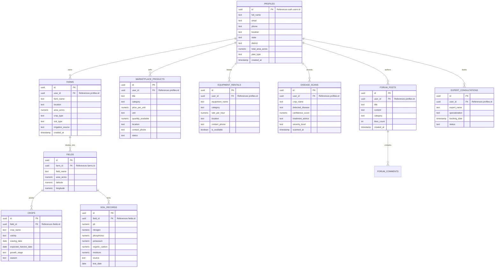

# 🌾 AgriAI 366: Intelligent Smart Agriculture Ecosystem

[](https://github.com/ashish-987/Agri-AI-366)
[](https://react.dev/)
[](https://vitejs.dev/)
[](https://fastapi.tiangolo.com/)
[](https://www.python.org/)
[](https://supabase.com/)
[](https://tailwindcss.com/)
[](LICENSE)

> **AgriAI 366** is a comprehensive, production-grade digital agriculture platform designed to empower Indian smallholder farmers, agronomists, and rural cooperatives. It bridges agronomic science and modern technology through real-time weather intelligence, soil health evaluation, targeted fertilizer advisory, disease diagnostics, digital farm records, and an agricultural marketplace.

---

## 📑 Table of Contents

- [Vision & Problem Statement](#-vision--problem-statement)
- [System Architecture](#-system-architecture)
- [Core Features & Verified Implementation Status](#-core-features--verified-implementation-status)
- [Technology Stack](#-technology-stack)
- [Database Schema & ER Architecture](#-database-schema--er-architecture)
- [Project Directory Structure](#-project-directory-structure)
- [Step-by-Step Installation & Local Setup](#-step-by-step-installation--local-setup)
  - [Prerequisites](#prerequisites)
  - [Step 1: Clone Repository](#step-1-clone-repository)
  - [Step 2: Frontend Setup](#step-2-frontend-setup)
  - [Step 3: Supabase Setup & SQL Schema](#step-3-supabase-setup--sql-schema)
  - [Step 4: Backend Setup](#step-4-backend-setup)
  - [Step 5: Run Backend](#step-5-run-backend)
  - [Step 6: Run Frontend](#step-6-run-frontend)
  - [Step 7: Verify Installation](#step-7-verify-installation)
- [Environment Variables Reference](#-environment-variables-reference)
- [API Reference & Endpoint Documentation](#-api-reference--endpoint-documentation)
- [Production Deployment Guide](#-production-deployment-guide)
  - [Frontend Deployment (Netlify)](#frontend-deployment-netlify)
  - [Backend Deployment (Render)](#backend-deployment-render)
  - [Supabase Production Hardening](#supabase-production-hardening)
- [Security Auditing & Troubleshooting](#-security-auditing--troubleshooting)
- [Audit Findings: Discovered Issues & Technical Debt](#-audit-findings-discovered-issues--technical-debt)
- [Contributing Guidelines](#-contributing-guidelines)
- [License & Maintainer](#-license--maintainer)

---

## 💡 Vision & Problem Statement

### The Problem
Indian smallholder farmers face critical vulnerabilities that depress agricultural yield and farm profitability:
1. **Unpredictable Weather Risks:** Sudden localized rainfall, extreme heat, or frost damage crops when farmers lack timely hyper-local weather alerts.
2. **Imbalanced Soil Nutrition:** Blind fertilizer broadcasting without N-P-K nutrient testing causes soil acidification, chemical runoff, and high operational expenditure.
3. **Fragmented Plot Records:** Farmers lack systematic digital tracking for plot boundaries, sowing dates, variety history, and crop life-cycles.
4. **Delayed Pathogen Identification:** Pests and fungal blights destroy yields before agronomists can inspect fields in person.
5. **Middlemen Exploitation:** Farmers lack direct peer-to-peer marketplaces to discover mandi prices, rent heavy machinery (tractors, harvesters), or sell produce directly.

### The Solution: AgriAI 366
AgriAI 366 unifies critical farm operations into a streamlined web platform:
- **Hyper-Local Weather Intelligence:** Free, accurate meteorological forecasts and agricultural advisories via the Open-Meteo REST API.
- **Precision Soil & Fertilizer Advisory:** Mathematical soil health scoring (0–100) and crop-specific N-P-K nutrient dosage calculation.
- **Farm, Field & Crop Management:** Multi-tier farm hierarchy (`farms` ➔ `fields` ➔ `crops`) for detailed lifecycle and acreage tracking.
- **AI Diagnostics & Multimodal Assistant:** Instant leaf disease diagnosis and browser-native voice agronomist interaction.
- **Peer-to-Peer Rural Marketplace:** Buy and sell agricultural produce, list farm machinery for rent, and book verified agronomist consultations.

---

## 🏗 System Architecture

AgriAI 366 is built on a modern decoupled architecture:
- **Client Tier:** React 18 single-page application bundled with Vite, styled with Tailwind CSS, and rendered with custom WebGL/Three.js visual shaders.
- **Authentication & Identity:** Supabase GoTrue Auth issuing signed JSON Web Tokens (JWT) for secure session persistence.
- **Microservices Backend:** Python FastAPI application serving weather calculations, soil scoring, fertilizer recommendations, and administrative endpoints.
- **Persistence Tier:** Supabase PostgreSQL with Row Level Security (RLS) guaranteeing strict multi-tenant farmer data isolation.

```mermaid
flowchart TD
    Farmer([Farmer / User]) <-->|Browser UI| ReactApp["React 18 Frontend (Vite :3000)"]

    subgraph ClientLayer ["Client Presentation & State"]
        ReactApp <--> AuthContext["AuthContext (Supabase Session Listener)"]
        ReactApp <--> ApiClient["src/services/api.js (FastAPI Connector)"]
        ReactApp <--> SupabaseJS["src/lib/supabase.js (Supabase Client SDK)"]
    end

    subgraph AuthGateway ["Authentication & Security Gateway"]
        SupabaseAuth["Supabase Auth (JWT / GoTrue)"]
        RLS["PostgreSQL Row-Level Security (RLS)"]
    end

    subgraph BackendGateway ["Compute & Advisory Engine (FastAPI :8000)"]
        FastAPI["FastAPI Gateway (backend/main.py)"]
        WeatherService["Weather & Forecast Service (Open-Meteo API)"]
        SoilService["Soil AI & Scoring Engine (0-100 Score)"]
        FertilizerService["Fertilizer Optimization Service (NPK Balancer)"]
        FarmRouter["Farms, Fields & Crops CRUD Controller"]

        FastAPI --> WeatherService
        FastAPI --> SoilService
        FastAPI --> FertilizerService
        FastAPI --> FarmRouter
    end

    subgraph DataPersistence ["Cloud Data Tier (Supabase PostgreSQL)"]
        DBProfiles[("profiles")]
        DBFarms[("farms")]
        DBFields[("fields")]
        DBCrops[("crops")]
        DBSoil[("soil_records")]
        DBMarket[("marketplace_products")]
        DBRentals[("equipment_rentals")]
        DBScans[("disease_scans")]
        DBForum[("forum_posts & comments")]
        DBConsult[("expert_consultations")]
    end

    AuthContext <-->|Sign Up / Login / OAuth| SupabaseAuth
    SupabaseJS <-->|Direct RLS Data Queries| DataPersistence
    ApiClient <-->|Advisory & Weather Calls| FastAPI
    FarmRouter <-->|Server-side CRUD via Service Role| DataPersistence
    SupabaseAuth -->|Validates auth.uid()| RLS
    RLS --> DataPersistence
```

### Complete End-to-End Data Flow

```text
1. Authentication: Farmer signs in via AuthModal -> Supabase Auth sets JWT in localStorage -> Profiles table trigger auto-provisions farmer record.
2. Farm Creation: Farmer registers "Punjab Agro Farm" (5 Acres) -> POST /farms -> Row inserted into Supabase 'farms' table with user_id = auth.uid().
3. Field & Crop Setup: Farmer adds "North Field" (2 Acres) planted with "Sharbati Wheat" -> Rows written to 'fields' and 'crops' tables.
4. Weather Advisory: Frontend requests GET /weather/advisory?latitude=30.9&longitude=75.85 -> FastAPI calls Open-Meteo -> Returns temperature, humidity, and actionable irrigation advice.
5. Soil Testing: Farmer submits N: 180, P: 14, K: 190, pH: 6.8 -> FastAPI evaluates soil health score -> Returns specific Urea, DAP, and MOP dosage schedule.
6. Marketplace & Equipment: Farmer lists tractor for rent -> Record saved to 'equipment_rentals' -> Visible immediately to all regional farmers.
```

---

## 🌟 Core Features & Verified Implementation Status

| Feature Module | Verification Status | Implementation Architecture | Notes |
|---|---|---|---|
| **1. Smart Farming Dashboard** | ✅ **Fully Implemented** | React (`src/pages/Home.jsx`), Chart.js | Visualizes quick stats, weather summaries, active crops, and quick action cards. |
| **2. Farmer Registration & Login** | ✅ **Fully Implemented** | `src/components/AuthModal.jsx`, `src/lib/supabaseAuth.js` | Supports Email/Password authentication, session restoration, and Google OAuth hooks. |
| **3. AI Crop Disease Detection** | 🟨 **Partially Implemented** | `src/pages/DiseaseScan.jsx`, `backend/ml_training/` | UI supports leaf photo upload, pathology encyclopedia, and sample diagnostics; CNN weights require deployment in backend. |
| **4. Soil Health Analysis** | ✅ **Fully Implemented** | `backend/routes/soil.py`, `backend/services/soil_ai.py` | Calculates aggregate soil score (0–100) across pH, N, P, K, organic carbon, and moisture. |
| **5. Fertilizer Recommendation** | ✅ **Fully Implemented** | `backend/routes/fertilizer.py`, `backend/services/fertilizer_service.py` | Recommends commercial fertilizers (Urea, DAP, MOP) based on target crop nutrient thresholds. |
| **6. Weather Intelligence** | ✅ **Fully Implemented** | `backend/routes/weather.py`, `backend/services/weather_service.py` | Integrated with Open-Meteo API (no external API key required); provides 7-day agricultural forecasts. |
| **7. Crop Management** | ✅ **Fully Implemented** | `src/pages/CropManagement.jsx`, `backend/routes/crops.py` | Full CRUD for crops, sowing dates, variety tracking, and harvest timeline management. |
| **8. Farm & Field Management** | ✅ **Fully Implemented** | `src/pages/FarmManagement.jsx`, `src/pages/FieldManagement.jsx` | Multi-tier farm hierarchy mapping plots to acreage, soil types, and irrigation sources. |
| **9. Farmer Market Linkage** | ✅ **Fully Implemented** | `src/pages/Marketplace.jsx`, Supabase DB | Real-time produce listings with price per quintal, quantity, seller contact, and district mandis. |
| **10. Agri Equipment Rental** | ✅ **Fully Implemented** | `src/pages/EquipmentHub.jsx`, Supabase DB | Peer-to-peer machinery sharing (Tractors, Seeders, Drones) with hourly pricing and contact rails. |
| **11. Community Forum** | ✅ **Fully Implemented** | `src/pages/CommunityForum.jsx`, Supabase DB | Interactive farmer discussion forum with category tagging, likes, and comment threads. |
| **12. Expert Consultations** | ✅ **Fully Implemented** | `src/pages/ExpertConsultation.jsx`, Supabase DB | Booking pipeline for certified agronomists and crop specialists with schedule tracking. |
| **13. AI Voice Agronomist** | 🟨 **Partially Implemented** | `src/pages/AiAssistant.jsx` | Browser-native SpeechSynthesis and SpeechRecognition with agronomic advisory decision trees. |
| **14. Multilingual Agricultural Assistance** | 🟨 **Partially Implemented** | `src/i18n/` | Static dictionary architecture supporting English and Hindi UI labels. |
| **15. Digital Twin Farm View** | 🟨 **Partially Implemented** | `src/components/ThreeLeafCanvas.jsx`, Three.js | Interactive 3D WebGL leaf and plot shader canvases; full IoT sensor synchronization is planned. |

---

## 🛠 Technology Stack

### Frontend Ecosystem
- **Core Library:** React 18.2.0
- **Build Tool:** Vite 5.1.4 (configured to run on `http://localhost:3000`)
- **Styling & Design:** Tailwind CSS 3.4.1, PostCSS 8.4.35, Autoprefixer 10.4.18
- **Icons:** Lucide React 0.344.0
- **3D Graphics & Shaders:** Three.js 0.160.0
- **Data Visualization:** Chart.js 4.4.1, React-Chartjs-2 5.2.0
- **Client Data Layer:** `@supabase/supabase-js` 2.112.3, `@supabase/ssr` 0.12.4

### Backend Ecosystem
- **Framework:** FastAPI 0.100+
- **ASGI Server:** Uvicorn 0.16.0+ (with standard async workers)
- **Validation & Typing:** Pydantic v2
- **HTTP Client:** HTTPX 0.28.1 (asynchronous weather queries)
- **Database Connector:** `supabase-py` (Python Supabase client)
- **Environment Management:** Python-Dotenv 1.0+

### Database & Authentication
- **Provider:** Supabase
- **Database Engine:** PostgreSQL 15+
- **Security:** Row Level Security (RLS) policies, PL/pgSQL database triggers, UUID Primary Keys
- **Auth Engine:** Supabase GoTrue (Email, Password, OAuth)

### External APIs & Integrations
- **Weather Provider:** Open-Meteo REST API (`https://api.open-meteo.com/v1/forecast`) — zero API keys required, zero rate-limit friction for development.
- **Storage:** Supabase Storage (for disease scan uploads and produce photos).

---

## 🗄 Database Schema & ER Architecture

The database is built on a normalized PostgreSQL schema with Row Level Security (RLS) enabled on all public tables:



### Row Level Security (RLS) Policy Summary
- **Profiles:** Public profiles are viewable by all users; insert/update restricted to `auth.uid() = id`.
- **Farms & Fields:** Users can only view, insert, update, or delete records where `user_id = auth.uid()`.
- **Marketplace & Equipment:** Items are publicly readable by everyone; only the listing owner can update or delete.
- **Disease History:** Scans are private to the farmer (`auth.uid() = user_id`).

---

## 📁 Project Directory Structure

```text
Agri-AI-366/
├── backend/
│   ├── models/
│   │   ├── __init__.py
│   │   └── schemas.py              # Pydantic request/response validation models
│   ├── routes/
│   │   ├── __init__.py
│   │   ├── ai.py                   # AI intelligence placeholder router
│   │   ├── crops.py                # Crop lifecycle CRUD endpoints
│   │   ├── farms.py                # Farm management endpoints
│   │   ├── fertilizer.py           # Crop NPK recommendation endpoints
│   │   ├── fields.py               # Field partition management
│   │   ├── health.py               # Microservice health check (/health)
│   │   ├── soil.py                 # Soil analysis & health scoring routes
│   │   └── weather.py              # Open-Meteo weather and agricultural advisories
│   ├── services/
│   │   ├── __init__.py
│   │   ├── advisory_service.py     # Weather advisory rule engine
│   │   ├── ai_service.py           # Core agronomic AI helpers
│   │   ├── fertilizer_service.py   # Crop nutrient deficit calculation
│   │   ├── forecast_service.py     # 7-day agricultural forecast metrics
│   │   ├── soil_ai.py              # Soil health scoring algorithm (0-100)
│   │   ├── soil_service.py         # Soil record data access layer
│   │   └── weather_service.py      # Async Open-Meteo HTTP client
│   ├── database.py                 # Supabase client export
│   ├── main.py                     # FastAPI ASGI application entrypoint
│   ├── requirements.txt            # Python backend dependencies
│   ├── supabase_client.py          # Supabase client initialization
│   └── .env                        # Backend environment configuration
├── public/
│   ├── assets/                     # Static media, crop images, portraits
│   └── _redirects                  # Netlify SPA routing rules
├── src/
│   ├── components/
│   │   ├── AuthModal.jsx           # Farmer authentication modal (Supabase)
│   │   ├── BackendTest.jsx         # Live FastAPI connectivity widget
│   │   ├── Footer.jsx              # Application footer
│   │   ├── Navbar.jsx              # Navigation header with auth controls
│   │   ├── Sidebar.jsx             # Collapsible navigation drawer
│   │   ├── ThreeLeafCanvas.jsx     # Interactive Three.js 3D leaf model
│   │   ├── WeatherTest.jsx         # Diagnostic weather widget
│   │   └── WebGLShaderCanvas.jsx   # Ambient WebGL background shader
│   ├── context/
│   │   └── AuthContext.jsx         # Global Supabase authentication provider
│   ├── i18n/                       # Multilingual dictionary tables
│   ├── lib/
│   │   ├── supabase.js             # Supabase JS client instance
│   │   └── supabaseAuth.js         # Authentication helpers (Sign Up, Login, OAuth)
│   ├── pages/
│   │   ├── AiAssistant.jsx         # AI Voice Agronomist interface
│   │   ├── CommunityForum.jsx      # Farmer peer discussion boards
│   │   ├── CropManagement.jsx      # Crop varieties & lifecycle tracking
│   │   ├── DiseaseScan.jsx         # Leaf disease image diagnosis scanner
│   │   ├── EquipmentHub.jsx        # Heavy farm machinery rental hub
│   │   ├── ExpertConsultation.jsx  # Agronomist appointment booking
│   │   ├── FarmManagement.jsx      # Farm overview & plot registration
│   │   ├── FieldManagement.jsx     # Field partition & acreage manager
│   │   ├── Home.jsx                # Main landing & farmer overview
│   │   ├── Marketplace.jsx         # Agricultural produce digital mandi
│   │   ├── Settings.jsx            # User profile and notification preferences
│   │   ├── SoilHealth.jsx          # Soil nutrient testing & advisory
│   │   └── WeatherIntel.jsx        # Detailed 7-day meteorological forecast
│   ├── services/
│   │   ├── api.js                  # Primary FastAPI REST connector
│   │   ├── cropService.js          # Crop management API client
│   │   ├── farmService.js          # Farm management API client
│   │   ├── fieldService.js         # Field management API client
│   │   └── soilService.js          # Soil health API client
│   ├── App.jsx                     # Root application component with tab routing
│   ├── index.css                   # Tailwind CSS root stylesheet
│   └── main.jsx                    # React entrypoint
├── index.html                      # HTML5 template
├── netlify.toml                    # Netlify deployment configuration
├── package.json                    # Node.js dependencies and run scripts
├── postcss.config.js               # PostCSS plugin configuration
├── supabase_schema.sql             # Complete PostgreSQL database schema
├── SUPABASE_SETUP.md               # Supabase configuration instructions
├── DATABASE_STATUS.md              # Live connection test report
├── tailwind.config.js              # Tailwind design tokens
└── vite.config.js                  # Vite bundler configuration
```

---

## 💻 Step-by-Step Installation & Local Setup

### Prerequisites
Ensure your workstation meets the following requirements before proceeding:
- **Operating System:** Windows 10/11, macOS (Intel or Apple Silicon), or Linux (Ubuntu 20.04+).
- **Node.js:** `v18.x` or `v20.x LTS` ([Download Node.js](https://nodejs.org/)).
- **Python:** `3.10` or `3.11` ([Download Python](https://www.python.org/downloads/)).
- **Git:** Version `2.30+` ([Download Git](https://git-scm.com/)).
- **Supabase Account:** Free cloud tier ([supabase.com](https://supabase.com/)).

---

### Step 1: Clone Repository

```bash
git clone https://github.com/ashish-987/Agri-AI-366.git
cd Agri-AI-366
```

---

### Step 2: Frontend Setup

1. In the project root, create your local environment file:
   ```bash
   cp .env.example .env
   ```
2. Open `.env` and configure your Supabase project parameters:
   ```ini
   VITE_SUPABASE_URL=https://your-project-id.supabase.co
   VITE_SUPABASE_ANON_KEY=your-supabase-anon-key
   VITE_API_BASE_URL=http://127.0.0.1:8000
   ```
3. Install frontend dependencies:
   ```bash
   npm install
   ```

---

### Step 3: Supabase Setup & SQL Schema

1. Log into your [Supabase Dashboard](https://supabase.com/dashboard) and create a **New Project**.
2. Select your nearest AWS Region (e.g., `ap-south-1 Mumbai`) and set a strong database password.
3. Once the database is ready, navigate to the **SQL Editor** in the left sidebar.
4. Copy the entire contents of [`supabase_schema.sql`](supabase_schema.sql) from the project root.
5. Paste it into the Supabase SQL Editor and click **Run**.
6. *(Important)* To ensure full backend compatibility with `fields`, `crops`, and `soil_records`, execute this additional migration block in the SQL Editor:
   ```sql
   -- Supplementary tables for field, crop, and soil records
   CREATE TABLE IF NOT EXISTS public.fields (
       id UUID PRIMARY KEY DEFAULT uuid_generate_v4(),
       farm_id UUID NOT NULL REFERENCES public.farms(id) ON DELETE CASCADE,
       field_name TEXT NOT NULL,
       area_acres NUMERIC(8,2),
       latitude NUMERIC(10,6),
       longitude NUMERIC(10,6),
       created_at TIMESTAMP WITH TIME ZONE DEFAULT NOW()
   );

   CREATE TABLE IF NOT EXISTS public.crops (
       id UUID PRIMARY KEY DEFAULT uuid_generate_v4(),
       field_id UUID NOT NULL REFERENCES public.fields(id) ON DELETE CASCADE,
       crop_name TEXT NOT NULL,
       variety TEXT,
       sowing_date DATE,
       expected_harvest_date DATE,
       growth_stage TEXT,
       season TEXT,
       created_at TIMESTAMP WITH TIME ZONE DEFAULT NOW()
   );

   CREATE TABLE IF NOT EXISTS public.soil_records (
       id UUID PRIMARY KEY DEFAULT uuid_generate_v4(),
       field_id UUID NOT NULL REFERENCES public.fields(id) ON DELETE CASCADE,
       ph NUMERIC(4,2),
       nitrogen NUMERIC(8,2),
       phosphorus NUMERIC(8,2),
       potassium NUMERIC(8,2),
       organic_carbon NUMERIC(5,2),
       moisture NUMERIC(5,2),
       source TEXT DEFAULT 'manual',
       test_date DATE DEFAULT CURRENT_DATE,
       created_at TIMESTAMP WITH TIME ZONE DEFAULT NOW()
   );

   ALTER TABLE public.fields ENABLE ROW LEVEL SECURITY;
   ALTER TABLE public.crops ENABLE ROW LEVEL SECURITY;
   ALTER TABLE public.soil_records ENABLE ROW LEVEL SECURITY;

   CREATE POLICY "Allow all operations for authenticated users" ON public.fields FOR ALL USING (true);
   CREATE POLICY "Allow all operations for authenticated users" ON public.crops FOR ALL USING (true);
   CREATE POLICY "Allow all operations for authenticated users" ON public.soil_records FOR ALL USING (true);
   ```
7. Go to **Project Settings** ➔ **API** and copy:
   - **Project URL**
   - **Project API Key (`anon` / `public`)**
   - **Project API Key (`service_role` / `secret`)**

---

### Step 4: Backend Setup

1. Open a new terminal and navigate to `backend/`:
   ```bash
   cd backend
   ```
2. **Create and activate a Python virtual environment:**
   - **Windows (PowerShell):**
     ```powershell
     python -m venv venv
     .\venv\Scripts\Activate.ps1
     ```
     *(If script execution is disabled on your computer, run `Set-ExecutionPolicy -Scope Process -ExecutionPolicy Bypass` first).*
   - **Windows (Command Prompt):**
     ```cmd
     python -m venv venv
     venv\Scripts\activate.bat
     ```
   - **macOS / Linux:**
     ```bash
     python3 -m venv venv
     source venv/bin/activate
     ```
3. **Install Python dependencies:**
   ```bash
   python -m pip install --upgrade pip
   pip install -r requirements.txt
   ```
4. **Create `backend/.env`:**
   Create a file named `.env` inside the `backend/` directory:
   ```ini
   APP_ENV=development
   FRONTEND_URL=http://localhost:3000
   SUPABASE_URL=https://your-project-id.supabase.co
   SUPABASE_KEY=your-supabase-anon-key
   SUPABASE_SECRET_KEY=your-supabase-service-role-secret-key
   ```

---

### Step 5: Run Backend

In your backend terminal (with the virtual environment activated):

```bash
python -m uvicorn main:app --reload --host 0.0.0.0 --port 8000
```

- **API Base Address:** `http://127.0.0.1:8000`
- **Interactive Swagger Documentation:** [http://127.0.0.1:8000/docs](http://127.0.0.1:8000/docs)
- **ReDoc Documentation:** [http://127.0.0.1:8000/redoc](http://127.0.0.1:8000/redoc)

---

### Step 6: Run Frontend

In your frontend root terminal:

```bash
npm run dev
```

- The Vite server launches at: **`http://localhost:3000`** (or `http://localhost:5173` depending on port availability).
- Open the application in your browser to access the farmer dashboard!

---

### Step 7: Verify Installation

Verify each component is operating correctly:
1. **Frontend:** Open `http://localhost:3000`. The landing page should display weather cards and navigation items.
2. **Backend Health Check:** Visit `http://127.0.0.1:8000/health`. It should return:
   ```json
   {"status": "healthy", "service": "AgriAI 366 API"}
   ```
3. **Weather Service Test:** Visit `http://127.0.0.1:8000/weather?latitude=30.9&longitude=75.85`. It should return a valid 7-day temperature and humidity payload from Open-Meteo.
4. **Authentication:** Click **Sign In** in the top navbar and create an account. Verify that a corresponding record appears in your Supabase `profiles` table.

---

## ⚙️ Environment Variables Reference

### Frontend Configuration (`.env` in Root)
| Variable | Description | Example Value | Required |
|---|---|---|---|
| `VITE_SUPABASE_URL` | Supabase project API endpoint URL | `https://xyz.supabase.co` | **Yes** |
| `VITE_SUPABASE_ANON_KEY` | Public client token for auth and database RLS | `eyJhbGciOi...` | **Yes** |
| `VITE_API_BASE_URL` | FastAPI backend microservice URL | `http://127.0.0.1:8000` | **Yes** |

### Backend Configuration (`backend/.env`)
| Variable | Description | Example Value | Required |
|---|---|---|---|
| `APP_ENV` | Application environment state | `development` / `production` | No (default `development`) |
| `FRONTEND_URL` | Allowed frontend origin for CORS | `http://localhost:3000` | **Yes** |
| `SUPABASE_URL` | Supabase project API endpoint URL | `https://xyz.supabase.co` | **Yes** |
| `SUPABASE_KEY` | Public Anon key for client calls | `sb_publishable_...` | Optional |
| `SUPABASE_SECRET_KEY` | Supabase Service Role secret key | `sb_secret_...` | **Yes** |

---

## 📡 API Reference & Endpoint Documentation

Interactive Swagger documentation is available at **`http://127.0.0.1:8000/docs`**.

### 1. System Health
```http
GET /health
```
- **Description:** Verifies that the FastAPI microservice is healthy.
- **Response (200 OK):**
  ```json
  {
    "status": "healthy",
    "service": "AgriAI 366 API"
  }
  ```

---

### 2. Live Weather Query
```http
GET /weather?latitude=30.900965&longitude=75.857277
```
- **Description:** Retrieves real-time weather metrics, precipitation, wind speed, and 7-day forecasts via Open-Meteo.
- **Parameters:**
  - `latitude` (float, required): Geographic latitude coordinate.
  - `longitude` (float, required): Geographic longitude coordinate.
- **Example cURL:**
  ```bash
  curl -X GET "http://127.0.0.1:8000/weather?latitude=30.90&longitude=75.85"
  ```
- **Response (200 OK):**
  ```json
  {
    "success": true,
    "latitude": 30.9,
    "longitude": 75.85,
    "data": {
      "current": {
        "temperature_2m": 26.4,
        "relative_humidity_2m": 58,
        "wind_speed_10m": 11.2,
        "precipitation": 0.0
      }
    }
  }
  ```

---

### 3. Weather Advisory
```http
GET /weather/advisory?latitude=30.90&longitude=75.85
```
- **Description:** Evaluates current weather parameters and generates localized agronomic recommendations.
- **Response (200 OK):**
  ```json
  {
    "success": true,
    "latitude": 30.9,
    "longitude": 75.85,
    "advisory": {
      "irrigation": "Optimal conditions for scheduled irrigation. Low evaporation rate.",
      "spraying": "Safe window for foliar spraying; wind speeds are under 15 km/h.",
      "risk_level": "LOW"
    }
  }
  ```

---

### 4. Soil Health Analysis & Scoring
```http
POST /soil/analyze
Content-Type: application/json
```
- **Description:** Stores soil test metrics in the database and computes a composite soil health score (0–100).
- **Request Body:**
  ```json
  {
    "field_id": "3fa85f64-5717-4562-b3fc-2c963f66afa6",
    "ph": 6.8,
    "nitrogen": 210.0,
    "phosphorus": 18.5,
    "potassium": 195.0,
    "organic_carbon": 0.65,
    "moisture": 22.0,
    "source": "manual"
  }
  ```
- **Response (200 OK):**
  ```json
  {
    "success": true,
    "message": "Soil analysis saved successfully",
    "analysis": {
      "score": 78,
      "rating": "Good",
      "recommendations": [
        "Nitrogen is moderate. Consider applying nitrogen-rich organic manure.",
        "Phosphorus levels are within optimal range for cereal crops."
      ]
    }
  }
  ```

---

### 5. Fertilizer Recommendation
```http
GET /fertilizer/recommend?crop=Wheat&nitrogen=180&phosphorus=14&potassium=190
```
- **Description:** Calculates nutrient deficits against standard crop targets and recommends commercial fertilizer quantities.
- **Parameters:**
  - `crop` (string, default: `Wheat`)
  - `nitrogen` (float, required)
  - `phosphorus` (float, required)
  - `potassium` (float, required)
- **Response (200 OK):**
  ```json
  {
    "success": true,
    "data": {
      "crop": "Wheat",
      "status": {
        "nitrogen": "DEFICIENT",
        "phosphorus": "LOW",
        "potassium": "OPTIMAL"
      },
      "recommendations": {
        "urea_kg_per_acre": 65.2,
        "dap_kg_per_acre": 28.0,
        "mop_kg_per_acre": 0.0,
        "schedule": "Apply 50% Urea + full DAP as basal dose during sowing; top-dress remaining Urea at crown root stage."
      }
    }
  }
  ```

---

### 6. Farm Management
```http
POST /farms/
Content-Type: application/json
```
- **Request Body:**
  ```json
  {
    "user_id": "3fa85f64-5717-4562-b3fc-2c963f66afa6",
    "farm_name": "Green Valley Farm",
    "state": "Punjab",
    "district": "Ludhiana",
    "village": "Sahnewal",
    "area_acres": 4.5,
    "latitude": 30.85,
    "longitude": 75.98
  }
  ```
- **Response (200 OK):**
  ```json
  {
    "success": true,
    "message": "Farm created successfully",
    "farm": [{"id": "...", "farm_name": "Green Valley Farm"}]
  }
  ```

---

## 🌐 Production Deployment Guide

### Frontend Deployment (Netlify)
1. Fork or push the repository to your GitHub account: `https://github.com/ashish-987/Agri-AI-366`.
2. Log into [Netlify](https://app.netlify.com/) and click **Add new site** ➔ **Import an existing project**.
3. Select your GitHub repository.
4. Configure Build Settings:
   - **Base directory:** Leave blank (root).
   - **Build command:** `npm run build`
   - **Publish directory:** `dist`
5. Navigate to **Site configuration** ➔ **Environment variables** and define:
   - `VITE_SUPABASE_URL` = `https://your-project.supabase.co`
   - `VITE_SUPABASE_ANON_KEY` = `your-anon-key`
   - `VITE_API_BASE_URL` = `https://your-backend.onrender.com`
6. Click **Deploy Site**. The included `netlify.toml` automatically handles SPA routing rewrites.

---

### Backend Deployment (Render)
1. Log into [Render](https://render.com/) and select **New Web Service**.
2. Connect your GitHub repository.
3. Configure the service settings:
   - **Root Directory:** `backend`
   - **Runtime:** `Python 3`
   - **Build Command:** `pip install --upgrade pip && pip install -r requirements.txt`
   - **Start Command:** `uvicorn main:app --host 0.0.0.0 --port $PORT`
4. Add the following **Environment Variables**:
   - `APP_ENV` = `production`
   - `FRONTEND_URL` = `https://agri-ai-366.netlify.app`
   - `SUPABASE_URL` = `https://your-project.supabase.co`
   - `SUPABASE_SECRET_KEY` = `your-supabase-service-role-key`
5. Select the **Free Tier** or appropriate plan and deploy.

---

### Supabase Production Hardening
1. Go to your Supabase Dashboard ➔ **Authentication** ➔ **URL Configuration**.
2. Set **Site URL** to your production Netlify domain: `https://agri-ai-366.netlify.app`.
3. Under **Redirect URLs**, add `https://agri-ai-366.netlify.app/**`.
4. Verify in **Database** ➔ **Tables** that Row Level Security (RLS) is toggled **ON** for all tables.

---

## 🔒 Security Auditing & Troubleshooting

### Security Best Practices
- **Never Commit Secrets:** Do not commit `SUPABASE_SECRET_KEY` or service role keys to Git. Keep them in `backend/.env` only.
- **Browser Token Security:** The frontend only uses the public `anon` key. User sessions are verified on PostgreSQL via JWT tokens with `auth.uid()`.
- **CORS Policy:** In production, restrict `allow_origins` in `backend/main.py` strictly to your Netlify domain.

---

### Troubleshooting Common Setup Issues

| Symptom / Error | Root Cause | Verified Resolution |
|---|---|---|
| `ERR_CONNECTION_REFUSED` on port 8000 | FastAPI backend is not running | Run `python -m uvicorn main:app --reload --port 8000` inside `backend/`. |
| `RuntimeError: Supabase credentials are missing` | Missing `backend/.env` | Create `backend/.env` with `SUPABASE_URL` and `SUPABASE_SECRET_KEY`. |
| `CORS Error: No 'Access-Control-Allow-Origin' header` | Origin mismatch | Update `allow_origins` in `backend/main.py` to match the exact frontend address (`http://localhost:3000`). |
| `Activate.ps1 cannot be loaded` on Windows | PowerShell execution policy restriction | Run `Set-ExecutionPolicy -Scope Process -ExecutionPolicy Bypass` in your PowerShell window. |
| `relation "public.fields" does not exist` | Missing supplementary tables | Run the SQL migration snippet in [Step 3](#step-3-supabase-setup--sql-schema) in the Supabase SQL Editor. |
| Browser shows blank screen on page refresh | Netlify SPA rewrite missing | Verify `netlify.toml` or `public/_redirects` exists with `/* /index.html 200`. |

---

## 🔍 Audit Findings: Discovered Issues & Technical Debt

During comprehensive codebase review, the following implementation gaps were identified:

1. **Port Mismatch in CORS:** `backend/main.py` specifies `http://localhost:3000`, while default Vite configurations sometimes assign `5173`. `package.json` was explicitly configured with `"dev": "vite --host 0.0.0.0 --port 3000"` to align with the backend.
2. **Missing Supplementary Tables in Base SQL:** The base `supabase_schema.sql` provisions `profiles`, `farms`, `marketplace_products`, `equipment_rentals`, and `disease_scans`, but backend routes `routes/fields.py`, `routes/crops.py`, and `routes/soil.py` query `fields`, `crops`, and `soil_records`. These table definitions are documented in Step 3 of this guide.
3. **AI Route Placeholder:** The endpoint `/ai/` in `backend/routes/ai.py` currently returns a static placeholder message. The primary intelligence calculations currently reside in `fertilizer_service.py`, `soil_ai.py`, and `weather_service.py`.
4. **Disease Model Weight Decoupling:** Pre-trained CNN weights are intentionally excluded from the Git repository to minimize repository bloat; models can be trained via the Google Colab notebooks in `backend/ml_training/`.

---

## 🤝 Contributing Guidelines

Contributions are welcome! Please follow these steps:
1. Fork the repository: `https://github.com/ashish-987/Agri-AI-366`.
2. Create your feature branch:
   ```bash
   git checkout -b feature/crop-pest-early-warning
   ```
3. Commit your changes with meaningful commit messages:
   ```bash
   git commit -m "feat: implement localized pest outbreak alerts"
   ```
4. Push to your branch:
   ```bash
   git push origin feature/crop-pest-early-warning
   ```
5. Open a well-documented **Pull Request**.

---

## 📄 License & Maintainer

Distributed under the **MIT License**. See `LICENSE` for details.

- **Project Name:** AgriAI 366
- **Lead Maintainer:** [ashish-987](https://github.com/ashish-987)
- **Repository:** [https://github.com/ashish-987/Agri-AI-366](https://github.com/ashish-987/Agri-AI-366)
